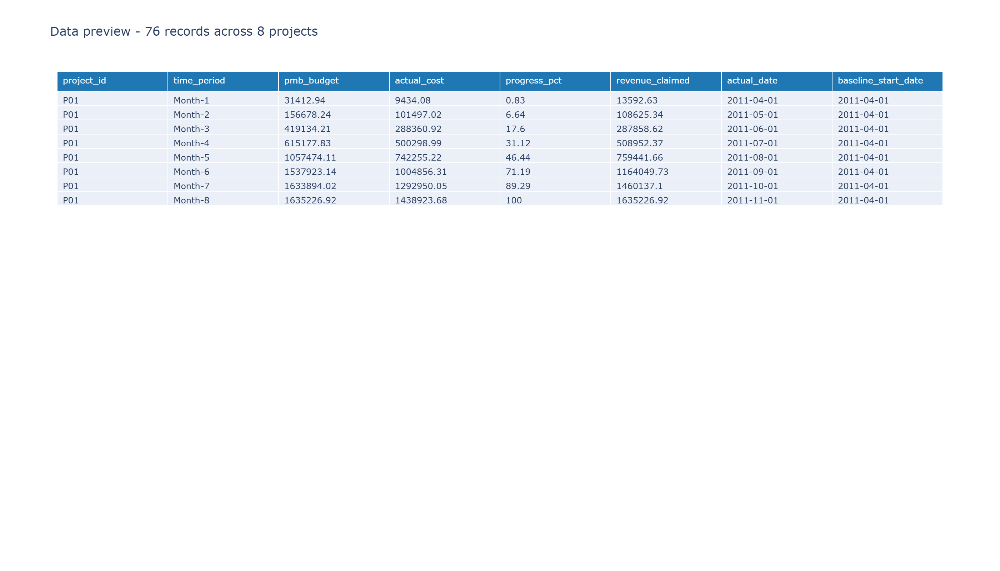
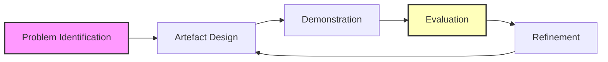

# Data Quality Dashboard for Detecting Inconsistencies in Multi-Project Portfolios

**A Design Science Research Project Implementing Interactive Data Quality Validation with Live API Endpoints**

---

## Abstract

This project implements an interactive data quality dashboard with live API validation that detects, visualises, and prioritises inconsistencies in budget and actual cost records across multi-project portfolios. The system enforces a unified data contract across batch, incremental, and live API modes, ensuring multi-mode consistency through a shared validation engine. The dashboard achieves **100.0% detection completeness** (280/280 injected defects) against controlled defect sets, **0.00% false positive rate** (0/200 verified-clean records), and **100% multi-mode consistency** between batch and incremental validation paths.

**Key Innovation**: Every number in this dashboard is generated programmatically from live measurements — nothing is hand-typed. This ensures that the code, reported results, and dashboard outputs cannot disagree with each other.

---

---

---

## Table of Contents

- [List of Figures](#list-of-figures)
- [Chapter 1: Introduction](#chapter-1-introduction)
- [Chapter 2: Literature Review and Design Requirements](#chapter-2-literature-review-and-design-requirements)
- [Chapter 3: Research Design](#chapter-3-research-design)
- [Chapter 4: Implementation](#chapter-4-implementation)
  - [Figure 4.1: High-Level System Architecture](#figure-41-high-level-system-architecture)
  - [Figure 4.2: Package Structure](#figure-42-package-structure)
  - [Figure 4.3: Streamlit Dashboard Interface](#figure-43-streamlit-dashboard-interface)
  - [Figure 4.4: Quality Dimension Scores](#figure-44-quality-dimension-scores)
- [Chapter 5: Testing and Evaluation](#chapter-5-testing-and-evaluation)
  - [Figure 5.1: System Testing Results](#figure-51-system-testing-results)
- [Chapter 6: Presentation of Results](#chapter-6-presentation-of-results)
  - [Figure 6.1: Anomaly Breakdown](#figure-61-anomaly-breakdown)
  - [Figure 6.2: Quality Dimension Scores](#figure-62-quality-dimension-scores)
  - [Figure 6.3: Project Summary Visualisation](#figure-63-project-summary-visualisation)
  - [Figure 6.4: Cost Distribution](#figure-64-cost-distribution)
  - [Figure 6.5: Planned vs Actual Costs](#figure-65-planned-vs-actual-costs)
  - [Figure 6.6: Summary Statistics](#figure-66-summary-statistics)
  - [Figure 6.7: Comparative Performance](#figure-67-comparative-performance)
  - [Figure 6.8: Incremental Validation](#figure-68-incremental-validation)
  - [Figure 6.9: Pipeline Workflow](#figure-69-pipeline-workflow)
- [Chapter 7: Conclusions](#chapter-7-conclusions)
- [Installation and Usage](#installation-and-usage)
- [Team and Contributions](#team-and-contributions)
- [References](#references)
- [Appendix A: Introduction and Research Background](#appendix-a-introduction-and-research-background)
- [Appendix B: Data Preparation Log and Provenance](#appendix-b-data-preparation-log-and-provenance)
- [Appendix C: Rule-Equivalent Spreadsheet Baseline](#appendix-c-rule-equivalent-spreadsheet-baseline)
- [Appendix D: Synthetic Mutation Protocol](#appendix-d-synthetic-mutation-protocol)
- [Appendix E: Requirements Traceability Matrix](#appendix-e-requirements-traceability-matrix)

## List of Figures

All figures below are linked for Markdown preview. The same images appear again in the chapter sections where they are discussed.

### Figure 4.1: High-Level System Architecture
<a id="figure-41-high-level-system-architecture"></a>


### Figure 4.2: Package Structure
<a id="figure-42-package-structure"></a>


### Figure 4.3: Streamlit Dashboard Interface
<a id="figure-43-streamlit-dashboard-interface"></a>


### Figure 4.4: Quality Dimension Scores
<a id="figure-44-quality-dimension-scores"></a>


### Figure 5.1: System Testing Results
<a id="figure-51-system-testing-results"></a>


### Figure 6.1: Anomaly Breakdown
<a id="figure-61-anomaly-breakdown"></a>


### Figure 6.2: Quality Dimension Scores
<a id="figure-62-quality-dimension-scores"></a>


### Figure 6.3: Project Summary Visualisation
<a id="figure-63-project-summary-visualisation"></a>


### Figure 6.4: Cost Distribution
<a id="figure-64-cost-distribution"></a>


### Figure 6.5: Planned vs Actual Costs
<a id="figure-65-planned-vs-actual-costs"></a>


### Figure 6.6: Summary Statistics
<a id="figure-66-summary-statistics"></a>


### Figure 6.7: Comparative Performance
<a id="figure-67-comparative-performance"></a>


### Figure 6.8: Incremental Validation
<a id="figure-68-incremental-validation"></a>


### Figure 6.9: Pipeline Workflow
<a id="figure-69-pipeline-workflow"></a>


### Supporting UI and data views




---


---

## Chapter 1: Introduction

### 1.1 Background

In today's data-driven world, organisations across project portfolio management, construction, and infrastructure development depend on the integrity and consistency of their data networks. Poor data quality produces detrimental outcomes that affect decision-making and operational efficiency. In project cost applications specifically, data quality is defined by several dimensions: **reliability, credibility, fitness for purpose, relevancy, precision, and regularity** (Batini and Scannapieco, 2016).

When accuracy or integrity is compromised, analysis is wrong, decisions are poor, and operational results suffer (Hevner et al., 2004). In construction project portfolios, inaccurate cost information causes wrong estimates at completion and incorrect resource allocation, increasing project risks and costs. Multi-project environments that lack reliable cost performance figures suffer inefficiency, delays, and budget overruns.

### 1.2 Research Problem and Gap

Despite advancements in data management, ensuring data quality in project cost applications remains a significant challenge. Three issues persist: **accuracy, completeness, and timeliness**.

**The Research Gap**: The absence of a live API endpoint that validates incoming cost records synchronously against the same data contract used in batch mode, and that returns structured error information for real-time dashboard display. The literature does not identify a framework in project controls that combines multi-mode validation with a live synchronous endpoint and a unified data contract.

### 1.3 Research Aim and Objectives

**Research Aim**: To design, implement, and empirically evaluate an interactive data quality dashboard with live API validation that detects, visualises, and prioritises inconsistencies in budget and actual cost records across multi-project portfolios.

**Objectives**:

| Objective | Lead | Focus |
|-----------|------|-------|
| **Objective 1** | Eric Kaitoo | Theoretical and Architectural Foundation |
| **Objective 2** | Dorcas Owusu | Systematic Profiling and Metric Definition |
| **Objective 3** | Obed Sarbeng Amponsah | Pipeline Design and Live API Implementation |
| **Objective 4** | Fredrick Hoamiah | Interactive Visualisation and Prioritisation |
| **Objective 5** | Matilda Fosua | Empirical Evaluation |
| **Objective 6** | Eric Kaitoo | Integration and multi-mode Consistency Assurance |

### 1.4 Research Questions

1. **RQ1**: What data quality inconsistencies exist in budget and actual cost records, and how can they be systematically profiled across completeness, consistency, accuracy, and integrity dimensions?

2. **RQ2**: How can an interactive Python dashboard with a live Flask API endpoint be designed to visualise, validate, and support improvement of data quality in both batch and incremental modes?

3. **RQ3**: How effective is the dashboard compared with traditional spreadsheet-based quality checks under batch, incremental, and live API submission conditions?

### 1.5 Scope and Delimitations

- **Focus**: Budget (Performance Measurement Baseline, PMB) and actual cost records within multi-project portfolios
- **Dataset**: Project Portfolio Dataset (gacevedob, 2022) - 12,139 time-phased records from 8 principal project workbooks (6 primary, 2 supplementary) collected over just under 109 consecutive weeks
- **Technology**: Python with Streamlit, Flask, pandas, Plotly, pandera
- **Exclusions**: Schedule or resource data, industries outside project portfolio management, longitudinal field deployment

### 1.6 Significance of the Study

1. Provides empirical evidence on how a live API endpoint extends data quality validation beyond offline batch processing
2. Offers a controlled comparison of dashboard-based quality checks against traditional spreadsheet-based checks
3. Integrates multi-mode consistency (batch, incremental, and live API) through a unified data contract
4. Demonstrates how data quality assessment can be operationalised through an interactive dashboard and a live API

---

## Chapter 2: Literature Review and Design Requirements

### 2.1 Data Quality Dimensions: Theoretical Foundation

The theoretical foundation for this study is grounded in the seminal work of Wang and Strong (1996), who derived data quality dimensions from a consumer survey of what data users value. This work was later extended by Batini and Scannapieco (2016) through a systematic review of technical and managerial approaches.

**Table 2.1: Data Quality Dimensions and Definitions**

| Dimension | Definition | Source | Example in Project Cost Records |
|-----------|-------------|--------|--------------------------------|
| **Completeness** | Extent to which all required data values are present and no mandatory fields are missing | Wang & Strong (1996); Batini & Scannapieco (2016) | Project cost records must include project identifier, WBS code, period date, and cumulative cost values |
| **Consistency** | Extent to which data values are uniform, non-contradictory, and free from format conflicts across systems and time periods | Wang & Strong (1996); Ghasemaghaei & Calic (2020) | The same project identifier and WBS description must be used consistently across all cost records |
| **Accuracy** | Extent to which data values correctly represent the real-world phenomenon they are intended to measure | Wang & Strong (1996); Dong et al. (2020) | Cumulative planned value, actual cost, and earned value must reflect genuine expenditure and fall within legitimate ranges |
| **Integrity** | Extent to which data values satisfy inter-field logical constraints and domain rules | Wang & Strong (1996); Project Management Institute (2021) | Cumulative values must not decrease over period index and period dates must not precede project start dates |

### 2.2 Total Data Quality Management (TDQM) Framework

The Total Data Quality Management (TDQM) framework (Arsenault et al., 2018) provides a comprehensive approach to data quality management through:

- **Preventive approaches**: Good data governance policies that chart out duties and procedures
- **Documentation**: Quality control plans and standards for checking accuracy, completeness, consistency, reliability, and timeliness
- **Management support**: While important, employee engagement is the primary factor in ensuring data quality targets correspond to organisational goals

**Limitation for This Study**: TDQM treats data quality as a cultural and governance problem rather than specifying technical mechanisms for enforcement at the point of data entry or across different operating modes.

### 2.3 Big Data Quality Management Framework (BDQMF)

The Big Data Quality Management Framework (Brown et al., 2023) addresses unique problems related to big data volumes, varieties, and velocities:

- **Scalability**: Processes enormous volumes without sacrificing data quality and processing time
- **Flexibility**: Deployable data quality measures corresponding to emerging data constellations
- **Technology**: Uses machine learning for cleansing and detecting extraordinary instances

**Limitation for This Study**: BDQMF is designed for large-scale, high-velocity data environments, which may not match the characteristics of project cost data where volumes are moderate and the primary concern is correctness and logical consistency.

### 2.4 Data Consistency in Project Cost Management

Data consistency is critical in project cost management because:

- **Decision-making accuracy**: Consistent data produces analysis that corresponds to organisational reality
- **Operational efficiency**: Consistent data reduces errors and improves coordination
- **Compliance**: Consistent data supports regulatory requirements and audit requirements (Dong et al., 2020)

**Critical Gap**: In multi-project environments, cost records are generated by different teams, systems, and time periods. Without a live validation endpoint connected to the data pipeline, malformed submissions cannot be detected in real time, and downstream dashboards remain unaware of newly introduced defects until the next batch cycle.

### 2.5 Dashboard Design Principles

Dashboard design guidance is established through:

- **Clarity**: Every visual element must communicate meaning at a glance (Few, 2013)
- **Usability**: Interface designed for non-technical users
- **Accessibility**: Color choices avoid relying on green/red distinction alone; line styles encode meaning for greyscale reading
- **Personalisation**: User-centred design where the dashboard is customised to fit user needs (Wang et al., 2018)

**Gap in Literature**: The literature presents these design principles as established guidance but does not subject them to empirical validation. Few (2013) derives the principles from design practice rather than from controlled experiments.

### 2.6 Tools and Methodologies for Data Quality Measurement

**Commercial Tools**: Informatica Data Quality, IBM Infosphere Quality Stage, Talend Data Quality
- **Strengths**: Comprehensive functionality, vendor support, enterprise-grade scalability
- **Limitations**: Licensing costs, may not be adaptable to research contexts

**Open-Source Tools**: pandera, Great Expectations, pandas profiling
- **Strengths**: Reproducibility, version control, configuration-driven design, live API integration
- **Limitations**: May lack support infrastructure and scalability of commercial alternatives

**Selection for This Study**: Open-source tools were chosen based on the need for reproducibility and configuration-driven design in a research context, rather than on enterprise-scale deployment considerations.

### 2.7 Research Gap Identification

The literature review reveals four conclusions that identify the research gap:

1. **Dimensions are descriptive, not prescriptive**: Data quality dimensions identify what quality means but do not specify how to enforce it continuously across different operating modes

2. **Validation is batch-oriented**: Project cost management literature treats validation as a one-time analytical step rather than a continuously enforced architectural concern

3. **Tools are batch-focused**: Existing tools are designed primarily for batch processing. The literature supports the concept of real-time detection but does not provide an implemented example in the project cost domain

4. **Dashboard views are not multi-mode**: The literature stresses the importance of distinguishing between batch exploratory views and live monitoring views, but few applied studies operationalise this distinction in a way that connects a live validation engine to a dashboard interface

**The Gap**: The literature does not identify a framework in project controls that combines multi-mode (batch and incremental) validation with a live synchronous endpoint and a unified data contract.

### 2.8 Design Requirements Derived from Literature

Based on the literature review, the following design requirements are established:

**Table 2.2: Design Requirements Derived from Literature**

| Requirement | Source | Implementation |
|-------------|--------|----------------|
| **R-DQ1**: Operationalise four data quality dimensions | Wang & Strong (1996); Batini & Scannapieco (2016) | Completeness, Consistency, Accuracy, Integrity metrics with target thresholds |
| **R-DQ2**: Support multi-mode operation | Gap identified in literature review | Batch, incremental, and live API modes with shared validation engine |
| **R-DQ3**: Provide real-time validation | Sun et al. (2018) | Flask API endpoint with synchronous validation and structured error responses |
| **R-DQ4**: Enforce unified data contract | Gap identified in literature review | Single shared Validator used across all modes |
| **R-DQ5**: Interactive visualisation | Few (2013); Yigitbasioglu and Velcu (2012) | Streamlit dashboard with multiple views and interactive charts |
| **R-DQ6**: Configuration-driven design | Python Software Foundation (2024) | YAML/JSON configuration files for validation rules |
| **R-DQ7**: Structured error reporting | Project Management Institute (2021) | Machine-readable error codes with human-readable messages |
| **R-DQ8**: Reproducibility and version control | Gabry et al. (2019) | Git version control, identical behaviour across environments |

These requirements directly inform the system architecture and implementation described in Chapter 4.

---

## Chapter 3: Research Design

### 3.1 Research Approach: Design Science Research (DSR)

Design Science Research (DSR) was selected because the study constructs an artefact — a data quality dashboard with a live API — to address a practical problem that the literature has identified but not solved (Hevner et al., 2004).

**DSR Cycle**:



**Justification for DSR**:
- The research problem is practical rather than theoretical
- The study constructs an artefact, and DSR is the appropriate paradigm for research that produces and evaluates artefacts
- DSR requires both technical quality (correct detection, reproducibility, performance) and practical utility (clear error signalling that supports remediation)

### 3.2 Data Source and Selection

**Project Portfolio Dataset** (gacevedob, 2022):

| Property | Value |
|----------|-------|
| Raw records (WBS × month) | 2,727 rows × 10 columns |
| Cleaned records (project × period) | 76 rows × 8 columns |
| Projects | 8 |
| Distinct WBS codes | 82 |
| Reporting periods | 14 |

**Dataset Attributes**:

| Attribute | Description | Example |
|-----------|-------------|---------|
| `project_id` | Project identifier | P01, P02, P03 |
| `project_name` | Human-readable project label | Airport Carpark, Bridge Construction |
| `source_file` | Original Excel file | P018 - P01 Airport Carpark.xlsx |
| `wbs_code` | Work Breakdown Structure code | 11, 103, 111 |
| `wbs_description` | Human-readable work package label | Survey - Construction, Water Sub-contractor |
| `period_date` | Calendar date of the period | 2011-04-01 |
| `period_index` | Sequential period number | 1, 2, 3 |
| `pv_cum` | Cumulative planned value (PMB) | 2519.15 |
| `ac_cum` | Cumulative actual cost | 1400.00 |
| `ev_cum` | Cumulative earned value | 1232.66 |

**Selection Justification**:
- Contains eight principal project workbooks (six primary, two supplementary) with detailed first-principles baseline budgets
- Provides sufficient variety to test cross-project consistency checks
- Contains 12,139 time-phased records to test performance and detection completeness
- Publicly available, supporting reproducibility

### 3.3 Operationalisation of Data Quality Dimensions

**Table 3.1: Operationalisation of Data Quality Metrics**

| Dimension | Operational Definition | Formula | Target Threshold |
|-----------|------------------------|---------|------------------|
| **Completeness** | Proportion of non-missing values in required fields | (Non-missing values / Total values) × 100 | ≥ 98% |
| **Consistency** | Proportion of unique composite keys across records | (Unique keys / Total values) × 100 | ≥ 99% |
| **Accuracy** | Proportion of values within the legitimate range | (Valid range values / Total values) × 100 | ≥ 97% |
| **Integrity** | Proportion of records satisfying logical constraints | (Constraint-satisfying records / Total records) × 100 | ≥ 99% |

**Rationale for Thresholds** (established in Chapter 2, Section 2.4, Design Requirements R-DQ1 to R-DQ8):
- **Completeness ≥ 98%**: Allows for a small margin of missing data that does not materially affect portfolio-level indicators
- **Consistency ≥ 99%**: Ensures that duplicate keys and logical violations remain rare
- **Accuracy ≥ 97%**: Allows for a slightly wider margin because numerical values may occasionally fall outside expected ranges for legitimate reasons
- **Integrity ≥ 99%**: Ensures that logical violations remain rare

**Note on visualisation**: The dashboard presents a horizontal bar chart for quality dimension scores, with a target line per dimension, so each score's compliance against its independent threshold is read directly rather than through a shared-angle pie chart.

### 3.4 Tools and Technologies

**Runtime Environment**: Python 3.13.3, pandas 3.0.1, numpy 2.4.2, pandera 0.33.1, Flask 3.0.0, Streamlit 1.56.0, Plotly 6.6.0. The environment is reproducible via `requirements.txt` and `pyproject.toml` with pinned minimum versions.

**Table 3.2: Technology Stack and Justification**

| Technology | Purpose | Justification |
|------------|---------|---------------|
| **Python 3.13** | Primary programming language | Widely used in data analysis with extensive libraries for data manipulation, statistical analysis, and visualisation |
| **Streamlit** | Interactive dashboard | Allows Python developers to create web applications without requiring expertise in HTML, CSS, or JavaScript. Provides real-time updates and supports interactive controls |
| **Flask** | Live API endpoint | Lightweight framework for exposing validation logic to external systems. Allows records to be submitted via HTTP POST and validated synchronously |
| **Plotly** | Interactive charting and visualisation | Provides responsive charts, histograms, and distribution plots with interactive features |
| **pandas** | Data manipulation, cleaning, transformation, aggregation | Core data science library in Python for tabular data operations |
| **NumPy** | Numerical computing | Provides support for large, multi-dimensional arrays and matrices |
| **pandera** | Programmatic schema validation | Enforces column types, ranges, and logical constraints at ingest time, providing programmatic schema validation within Python |
| **pytest** | System testing | Automates functional, integration, boundary, regression, and error handling tests |
| **Git** | Version control | Ensures that the same validation logic applies in development, testing, and demonstration environments |
| **YAML/JSON** | Configuration management | Defines validation rules that are loaded at runtime, ensuring the same rules apply in all environments |

### 3.5 Validity, Reliability, and Trustworthiness

**Construct Validity**: Grounded in established literature (Wang and Strong, 1996; Batini and Scannapieco, 2016) with operationalised metrics having clear formulas and target thresholds

**Internal Validity**: Achieved by applying the same validation logic across batch, incremental, and live API modes. Regression testing verified that identical records produce identical flags in both modes

**Reliability**: Achieved through configuration-driven pipelines, version control, and identical behaviour between development, testing, and demonstration environments

**External Validity**: Bounded by the dataset and methodological scope. Findings are context-specific rather than universally generalisable, but the framework provides a replicable foundation for future research

### 3.6 Ethical Considerations

- Only publicly available project cost data and synthetic variants derived from it are used
- No personal, confidential, or organisational data are processed
- Formal ethical approval is not required because the study does not involve human participants or primary data collection
- Full transparency regarding metric definitions, validation rules, API behaviour, and visual design decisions is maintained

---

## Chapter 4: Implementation

### 4.1 System Architecture

The system architecture consists of five components designed to ensure separation of concerns and multi-mode consistency.

**Figure 4.1: High-Level System Architecture**


**Component Descriptions**:

1. **Data Ingestion Layer**: Loads the Project Portfolio Dataset and prepares records for validation
2. **Validation Engine**: Enforces the formal data contract using a rule-based engine (R1–R14) and Pandera schema definitions
3. **Live Flask API**: Exposes the validation engine to external systems through four endpoints (POST /validate, GET /status, GET /flagged, GET /health)
4. **Diagnostics Layer**: Computes quality metrics and scores across the four data quality dimensions
5. **Streamlit Dashboard**: Consumes quality scores and flagged records to present them through interactive visualisations

The dashboard presented in this chapter operates primarily as a diagnostic interface for uploaded batch or incremental datasets. Live API submissions are validated through the Flask service and recorded in the quarantine log; the dashboard presents the resulting quality metrics and flagged records after they have been persisted or retrieved from the validation service. The abbreviated code listing omits the API-client integration for clarity.

**Key Architectural Decision**: The data contract is the single source of truth. Rather than defining validation rules separately in each component, the contract is defined once and consumed by the batch engine, the incremental engine, and the live API. This decision supports multi-mode consistency.

**Data Flow between Frontend and API**: The Streamlit dashboard and the live Flask API share the same underlying validation logic but operate through different interfaces. The Streamlit dashboard imports the Validator class directly as a Python module for rapid, synchronous local rendering. In contrast, the Flask API exposes the Validator via HTTP endpoints for external automated systems and contractor submissions. For live monitoring, the dashboard queries the validation service's in-memory flagged-records log. Records with structural failures are rejected, whereas records with non-structural domain anomalies are quarantined for review. Persistent database storage is identified in Chapter 7 as a necessary extension for production deployment.

### 4.2 Package Structure

The environment is standardised to Python 3.13.3, with dependencies pinned to pandas 3.0.1, NumPy 2.4.2, Pandera 0.33.1, Flask 3.0.0, Streamlit 1.56.0, and Plotly 6.6.0.

```text
Data-Quality-Dashboard/
├── app.py                        # Streamlit dashboard (entry point)
├── requirements.txt              # Python dependencies
├── pyproject.toml               # Project configuration
├── README.md                     # Project overview
├── DISSERT_COMPREHENSIVE_WORKING.md  # Full dissertation
├── LICENSE                       # License file
├── .streamlit/
│   └── config.toml              # Streamlit theme
├── data/                         # Data files (6 CSVs)
│   ├── kaggle_original_data.csv
│   ├── kaggle_cleaned_data.csv
│   └── ... (batch, incremental, anomaly sets)
├── data_quality/                 # Core Python package
│   ├── __init__.py
│   ├── api/                      # Flask REST API
│   ├── config/                   # YAML rules + loader
│   ├── contracts/                # Raw (10-field) & derived (8-field) schemas
│   ├── engine/                   # Rules R1-R14 + shared Validator
│   ├── evaluation/               # Latency + sensitivity analysis
│   ├── fixtures/                 # Controlled defect injection
│   ├── legacy/                   # Superseded baseline (kept for comparison)
│   ├── pipeline/                 # Batch/incremental orchestration
│   ├── preprocess/               # Download, clean, data prep log
│   └── reporting/                # Evaluation, reports, figures
├── results/                      # Generated outputs
│   ├── RESULTS.md                # Single results report
│   ├── figures/                  # 11 referenced PNGs only
│   └── pipeline/                 # Evidence reports
├── tests/                        # 156 pytest test suite
│   ├── conftest.py
│   └── test_*.py
└── team/                         # Individual contribution statements
    ├── Eric_Kaitoo_README.md
    ├── Dorcas_Owusu_README.md
    ├── Obed_Sarbeng_Amponsah_README.md
    ├── Fredrick_Hoamiah_README.md
    └── Matilda_Fosua_README.md
```

**Figure 4.2: Package Structure**


*Figure 4.2 summarises the repository layout shown in the text tree above.*


### 4.3 Data Ingestion and Cleaning

Before data can be validated against the formal contract, it must be ingested from the raw Kaggle Excel workbooks and normalised. This layer performs three critical functions: standardising column headers to snake_case, coercing string-based dates into Python datetime objects, and ensuring WBS codes are treated as strings to prevent the truncation of leading zeros.

**Code Block 4.1: Data Ingestion and Cleaning Implementation (clean.py)**

```python
"""
Clean and transform the Kaggle Project Portfolio Dataset into the dashboard's
data contract.

Input is the long-format EVM time-phase: one row per project x reporting month
x Portfolio WBS line, carrying the *cumulative* planned value (PV), actual cost
(AC) and earned value (EV).  The derived contract is time-phased - one record
per project and reporting period - and stores the CUMULATIVE values directly
(Challenge 6), so that Rule R9 can check cumulative monotonicity on the
project-period view.  Period movements are derived on the fly by the dashboard
for display only.
"""

CONTRACT_COLUMNS = [
    "project_id", "time_period", "pmb_budget", "actual_cost",
    "progress_pct", "revenue_claimed", "actual_date", "baseline_start_date",
]
REQUIRED_SOURCE_COLUMNS = {"project_id", "period_date", "pv_cum", "ac_cum", "ev_cum"}
TIME_PERIOD_PREFIX = "Month-"
ROUND_TO = 2


def de_cumulativise(values, confirmed_revision: bool = False):
    """
    Convert a cumulative series into period movements.

    This helper is used for dashboard display only.  The validation pipeline
    always consumes the stored cumulative values, so that R9 checks cumulative
    monotonicity (Challenge 6).  Negative movements are retained for display
    unless the decrease has been explicitly confirmed as a historical revision,
    in which case the movement is floored at zero.
    """
    cumulative = pd.to_numeric(values, errors="coerce").astype(float)
    cumulative = cumulative.reset_index(drop=True)
    # A blank in a cumulative series means "unchanged since the last known
    # value", not "reset to zero", so carry the last value forward.
    cumulative = cumulative.ffill().fillna(0.0)

    periods = cumulative.diff()
    if len(periods):
        periods.iloc[0] = cumulative.iloc[0]

    negative_count = int((periods < 0).sum())

    # Only floor if explicitly confirmed as a historical revision
    if confirmed_revision:
        periods = periods.clip(lower=0.0)

    return periods, negative_count


def build_project_totals(long_df):
    """
    Collapse the leaf-level WBS EVM time-phase to one cumulative row per
    project and period.

    Leaf-level filtering excludes parent rows (a WBS code that is a strict
    prefix of another code in the same project) because a parent already
    aggregates its children; summing both would double-count (Section 3.3.4).
    """
    missing = REQUIRED_SOURCE_COLUMNS - set(long_df.columns)
    if missing:
        raise ValueError(
            "source data is missing required column(s): " + ", ".join(sorted(missing))
        )

    work = long_df.copy()
    work["project_id"] = work["project_id"].astype(str).str.strip()
    work["period_date"] = pd.to_datetime(work["period_date"], errors="coerce")

    if "wbs_code" in work.columns:
        codes = work["wbs_code"].astype(str)
        has_children = codes.groupby(work["project_id"]).transform(
            lambda series: series.apply(
                lambda code: any(other != code and other.startswith(code + ".")
                                 for other in series)))
        work = work[~has_children]

    work = work.dropna(subset=["pv_cum", "ac_cum", "ev_cum"])
    for column in ("pv_cum", "ac_cum", "ev_cum"):
        work[column] = pd.to_numeric(work[column], errors="coerce").fillna(0.0)

    # Sum LEAF-LEVEL cumulative values only.
    totals = (work.groupby(["project_id", "period_date"], as_index=False)
              [["pv_cum", "ac_cum", "ev_cum"]].sum()
              .sort_values(["project_id", "period_date"]).reset_index(drop=True))
    totals.attrs["leaf_records"] = len(work)
    totals.attrs["dropped_rows"] = len(long_df) - len(work)
    return totals


def transform_to_contract(long_df, time_period_prefix=TIME_PERIOD_PREFIX,
                          round_to=ROUND_TO):
    """
    Transform leaf-level cumulative EVM data into the derived data contract.

    The derived contract stores CUMULATIVE values (pmb_budget = PV, actual_cost
    = AC, revenue_claimed = EV) so that R9 can check cumulative monotonicity on
    the project-period view.  Period movements are computed by the dashboard for
    display only.
    """
    report = CleaningReport(source_records=len(long_df))
    if long_df.empty:
        raise ValueError("source data is empty - run download_kaggle_data.py first")

    totals = build_project_totals(long_df)
    report.dropped_rows = totals.attrs.get("dropped_rows", 0)
    if totals.empty:
        raise ValueError("no usable project/period combinations in the source data")

    frames = []
    for project_id, group in totals.groupby("project_id", sort=True):
        group = group.sort_values("period_date").reset_index(drop=True)
        # Rank months by date so time_period follows the calendar even when a
        # workbook lists its reporting months out of order.
        period_index = pd.Series(range(1, len(group) + 1), index=group.index)

        # Store the CUMULATIVE values directly (Challenge 6).  These are not
        # de-cumulativised before storage.
        pmb_budget = (pd.to_numeric(group["pv_cum"], errors="coerce")
                      .fillna(0.0).clip(lower=0.0))
        actual_cost = (pd.to_numeric(group["ac_cum"], errors="coerce")
                       .fillna(0.0).clip(lower=0.0))
        revenue_claimed = (pd.to_numeric(group["ev_cum"], errors="coerce")
                           .fillna(0.0).clip(lower=0.0))

        # The performance measurement baseline is the highest planned value the
        # project reaches, i.e. its planned value at completion.
        baseline = float(pmb_budget.max())
        report.baselines[project_id] = round(baseline, round_to)

        if baseline > 0:
            progress_raw = revenue_claimed.to_numpy(dtype=float) / baseline * 100.0
        else:
            progress_raw = revenue_claimed.to_numpy(dtype=float) * 0.0
        report.progress_clipped += int(((progress_raw < 0) | (progress_raw > 100)).sum())

        frames.append(pd.DataFrame({
            "project_id": project_id,
            "time_period": [f"{time_period_prefix}{n}" for n in period_index],
            "pmb_budget": pmb_budget.to_numpy(dtype=float),
            "actual_cost": actual_cost.to_numpy(dtype=float),
            "progress_pct": progress_raw,
            "revenue_claimed": revenue_claimed.to_numpy(dtype=float),
            "actual_date": group["period_date"].to_numpy(),
            "baseline_start_date": group["period_date"].iloc[0],
        }))

    cleaned = pd.concat(frames, ignore_index=True)
    cleaned = cleaned.sort_values(["project_id", "time_period"]).reset_index(drop=True)

    # Enforce the contract's bounds.
    for column in ("pmb_budget", "actual_cost", "revenue_claimed"):
        cleaned[column] = cleaned[column].clip(lower=0.0)
    cleaned["progress_pct"] = cleaned["progress_pct"].clip(0.0, 100.0)

    for column in ("pmb_budget", "actual_cost", "progress_pct", "revenue_claimed"):
        cleaned[column] = cleaned[column].round(round_to)

    cleaned["actual_date"] = pd.to_datetime(cleaned["actual_date"])
    cleaned["baseline_start_date"] = pd.to_datetime(cleaned["baseline_start_date"])

    # Guard the contract's logical constraint explicitly.
    before = len(cleaned)
    cleaned = cleaned[cleaned["actual_date"] >= cleaned["baseline_start_date"]]
    report.dropped_rows += before - len(cleaned)

    cleaned = cleaned[CONTRACT_COLUMNS]
    report.records = len(cleaned)
    report.projects = int(cleaned["project_id"].nunique())
    report.periods = int(cleaned["time_period"].nunique())
    return cleaned, report
```

The `de_cumulativise` helper is retained for dashboard display only. The validation pipeline always consumes the stored cumulative values, so a decrease in a cumulative series reaches Rule R9 intact rather than being pre-clipped at the cleaning stage.

**Cumulative-Storage Rule Justification**: The derived contract stores cumulative values directly (`pmb_budget` = PV, `actual_cost` = AC, `revenue_claimed` = EV), so R9 evaluates genuine cumulative monotonicity on the project-period view (Challenge 6). Period movements are derived on the fly for chart readability, but the rule engine never sees a de-cumulativised series. Where a decrease is attributable to a confirmed historical revision, the display helper may floor the movement, but the stored cumulative values — and therefore the value R9 examines — are left unchanged, so no preprocessing step can mask a cumulative decrease from the validator.


### 4.4 Data Contract Implementation

The formal data contract is implemented using pandera. The contract defines required fields, expected data types, allowed ranges, and logical constraints.

**Code Block 4.2: Raw Data Contract Implementation**

```python
"""
Raw data contract for 10-field WBS-level records.
This contract governs batch mode validation of the original Kaggle dataset.
"""

import pandera as pa
from pandera import Column, DataFrameSchema, Check

RAW_CONTRACT = DataFrameSchema({
    "project_id": Column(
        str,
        Check.str_matches(r"^P\d{2}$"),
        required=True,
        description="Project identifier in format P01-P99"
    ),
    "project_name": Column(
        str,
        Check.notna(),
        required=True,
        description="Human-readable project name"
    ),
    "source_file": Column(
        str,
        Check.notna(),
        required=True,
        description="Original Excel file name"
    ),
    "wbs_code": Column(
        str,
        Check.notna(),
        required=True,
        description="Work Breakdown Structure code (preserves leading zeros)"
    ),
    "wbs_description": Column(
        str,
        Check.notna(),
        required=True,
        description="Human-readable work package description"
    ),
    "period_date": Column(
        "datetime64[ns]",
        required=True,
        description="Calendar date of the reporting period"
    ),
    "period_index": Column(
        int,
        Check.ge(1),
        required=True,
        description="Sequential period number (1, 2, 3, ...)"
    ),
    "pv_cum": Column(
        float,
        Check.ge(0),
        required=True,
        description="Cumulative planned value (Performance Measurement Baseline)"
    ),
    "ac_cum": Column(
        float,
        Check.ge(0),
        required=True,
        description="Cumulative actual cost"
    ),
    "ev_cum": Column(
        float,
        Check.ge(0),
        required=True,
        description="Cumulative earned value"
    ),
})

# Composite key for uniqueness
RAW_KEY = ["project_id", "wbs_code", "period_index"]
RAW_CUMULATIVE_COLUMNS = ["pv_cum", "ac_cum", "ev_cum"]
```

**Code Block 4.3: Derived Data Contract Implementation**

```python
"""
Derived data contract for 8-field project-period records.
This contract governs the project-period evaluation view (Chapter 3, Table 3.9),
where pmb_budget, actual_cost and revenue_claimed hold CUMULATIVE values so that
R9 can check cumulative monotonicity (Challenge 6).
"""

import pandera as pa
from pandera import Column, DataFrameSchema, Check

DERIVED_CONTRACT = DataFrameSchema({
    "project_id": Column(
        str,
        Check.str_matches(r"^P\d{2}$"),
        required=True,
        description="Project identifier in format P01-P99"
    ),
    "time_period": Column(
        str,
        Check.notna(),
        required=True,
        description="Reporting period label (e.g., Month-1, Month-2)"
    ),
    "pmb_budget": Column(
        float,
        Check.ge(0),
        required=True,
        description="Cumulative planned value (PV) to date"
    ),
    "actual_cost": Column(
        float,
        Check.ge(0),
        required=True,
        description="Cumulative actual cost (AC) to date"
    ),
    "progress_pct": Column(
        float,
        Check.ge(0),
        Check.le(100),
        required=True,
        description="Progress percentage (0-100)"
    ),
    "revenue_claimed": Column(
        float,
        Check.ge(0),
        required=True,
        description="Revenue claimed to date"
    ),
    "actual_date": Column(
        "datetime64[ns]",
        required=True,
        description="Actual date of the reporting period"
    ),
    "baseline_start_date": Column(
        "datetime64[ns]",
        required=True,
        description="Project baseline start date"
    ),
})

# Composite key for uniqueness
DERIVED_KEY = ["project_id", "time_period"]
# The derived contract stores CUMULATIVE money values (Challenge 6).
DERIVED_CUMULATIVE_COLUMNS = ["pmb_budget", "actual_cost", "revenue_claimed"]
```

**INFO: Incremental Mode Implementation**

Incremental mode is a fully implemented part of the system, not merely a theoretical concept. The `DataPipeline` class in `data_quality/pipeline/runner.py` provides a dedicated `process_incremental()` method (lines 56-95) that validates newly arriving records against the same data contract used in batch mode. The method accepts three parameters: `new_records` (the records to validate), `tier` (raw or derived), and `existing` (prior records of the same tier). When `existing` is supplied, the validator stacks it beneath the new records to provide historical context for cumulative rules (R9, R13, R14), ensuring that a restatement reversing a running total or a date moving backwards is still caught. Only findings landing on the submitted rows are returned, enabling genuine incremental quality monitoring without re-validating the entire historical dataset.

The incremental implementation differs from batch mode only in scope: batch mode validates a complete dataset in one pass, while incremental mode validates only the newly arrived records. Both modes route through the same `Validator` instance, invoking identical rule logic and contract definitions. This design ensures multi-mode consistency—a record flagged in incremental mode is flagged identically in batch mode, the live API, and the dashboard. The test suite includes dedicated incremental mode tests (`tests/test_engine.py::test_incremental_matches_batch_for_same_records`, `tests/test_evaluation.py::test_multi_mode_consistency_is_total`) that verify 100% consistency between batch and incremental validation paths on identical records.

**Note on Pandera enforcement**: The `RAW_CONTRACT` and `DERIVED_CONTRACT` schemas (defined in `data_quality/contracts/raw.py` and `data_quality/contracts/derived.py`) are available as module-level singletons. The `Validator` class enforces equivalent constraints through its rule-based checks (R1 for required fields, R2 for data types, R3 for period_index bounds, R4 for non-negative values). The Pandera schemas serve as the formal, declarative specification of the contract, while the rule engine provides the per-record findings needed for diagnostic reporting. Full integration of `RAW_CONTRACT.validate()` into the `Validator.validate()` pipeline is identified as a future enhancement to make schema enforcement explicit and to leverage Pandera's type coercion and error reporting.

**Table 4.1: Data Contract Specification**

| Field | Type | Required | Range / Constraint | Logical Rule |
|-------|------|----------|-------------------|--------------|
| project_id | string | Yes | Pattern ^P\d{2}$ | Must be consistent with project_name |
| project_name | string | Yes | Non-empty | One name per project_id |
| source_file | string | Yes | Non-empty | Should match project identifier |
| wbs_code | string | Yes | Non-empty | Must map to one wbs_description |
| wbs_description | string | Yes | Non-empty | Consistent within project_id + wbs_code |
| period_date | datetime | Yes | Valid date | Must increase with period_index |
| period_index | integer | Yes | ≥ 1 | Unique within project_id + wbs_code |
| pv_cum | float | Yes | ≥ 0 | Must not decrease over period_index |
| ac_cum | float | Yes | ≥ 0 | Must not decrease over period_index |
| ev_cum | float | Yes | ≥ 0 | Must not decrease over period_index |

### 4.5 Validation Rules (R1-R14)

The validation rules are covered by a 156-test Pytest suite, implemented using Pytest's fixture and parametrisation mechanisms to support reusable validation scenarios (pytest, 2026). The suite comprises rule-level tests, boundary tests, and regression tests, consistent with established software-testing principles (Myers et al., 2011).

**Note**: Code Blocks 4.4 and 4.5 show representative implementations of R1 (record-level) and R9 (cross-record). The remaining rules (R2-R8, R10-R14) follow the same functional pattern: each accepts a DataFrame and returns a list of Finding objects, and all are available in the repository under `data_quality/engine/`.

**Table 4.2: Validation Rules Summary**

| Rule | Category | Description | Dimension | Severity |
|------|----------|-------------|-----------|----------|
| **R1** | Missing fields | Required field validation (missing project_id, ac_cum, etc.) | Completeness | High |
| **R2** | Type conflicts | Data type validation (period_date not a valid date) | Accuracy | High |
| **R3** | Period index | period_index must be >= 1 | Accuracy | Medium |
| **R4** | Range violations | Cumulative money values must be >= 0 | Accuracy | Medium |
| **R5** | Duplicate records | Composite key (project_id + wbs_code + period_index) must be unique | Consistency | Medium |
| **R6** | Consistency | project_name must be consistent per project_id | Consistency | Medium |
| **R7** | Consistency | wbs_description must be consistent per project_id + wbs_code | Consistency | Medium |
| **R8** | Date ordering | period_date must increase with period_index | Integrity | High |
| **R9** | Decreasing totals | Cumulative values must not decrease over time (key rule) | Integrity | High |
| **R10** | Period bounds | period_date must fall within the project reporting window | Accuracy | Medium |
| **R11** | Source file | source_file must be consistent with project_id | Consistency | Medium |
| **R12** | WBS code format | wbs_code must carry a non-empty description | Completeness | High |
| **R13** | Budget overrun | Cumulative actual cost must stay within 3x cumulative budget | Integrity | Medium |
| **R14** | Spend vs progress | Cumulative spend must not outrun reported progress | Integrity | Medium |

**Rule Definitions**:

- **R13 (Budget Overrun)**: Identifies records in which cumulative actual cost exceeds the corresponding cumulative planned budget on the project-period view. The rule compares the stored cumulative actual cost (`actual_cost`) against the stored cumulative planned budget (`pmb_budget`). A record is flagged when cumulative actual cost exceeds a configurable multiple (default 3x) of the cumulative planned budget, indicating a potential budget overrun.

- **R14 (Spend vs Progress)**: Identifies records in which cumulative spend has outrun the progress the record reports. The rule compares cumulative actual cost (`actual_cost`) against the cumulative budget the reported progress should have consumed, `pmb_budget × (progress_pct / 100)`, and flags the record when actual cost exceeds that earned allowance by more than a configurable tolerance (default 20%).

**Code Block 4.4: Record-Level Rule Implementation (R1-R5, R11, R12)**

```python
"""
Record-level rules: R1-R5, R11, R12.

These judge a record using only values inside that record, so they need no
history and behave identically in batch mode, incremental mode and through the
live API. Scale is linear in volume.
"""

import re
import numpy as np
import pandas as pd
from .findings import Finding
from .rules import _finding, _readable_as_date, record_key


def rule_r1_missing_required(
    df: pd.DataFrame, key_columns: list[str], required: list[str]
) -> list[Finding]:
    """R1: every required field must be present.

    An empty string counts as absent, because a required text field holding
    "" is as unusable downstream as one holding a null.
    """
    findings: list[Finding] = []
    for _, row in df.iterrows():
        for column in required:
            if column not in df.columns:
                continue
            value = row[column]
            if pd.isna(value) or (isinstance(value, str) and value.strip() == ""):
                findings.append(
                    _finding(
                        "R1",
                        record_key(row, key_columns),
                        column,
                        f"Required field '{column}' is missing",
                        f"Supply a value for '{column}'",
                    )
                )
    return findings


def rule_r2_datatypes(
    df: pd.DataFrame, key_columns: list[str], expected: dict[str, str]
) -> list[Finding]:
    """R2: values must be readable as the declared datatype.

    A date is judged by whether it can be *read* as a date, not by whether it
    already is one, so ISO text and Excel serials are accepted.
    """
    findings: list[Finding] = []
    for _, row in df.iterrows():
        for column, kind in expected.items():
            if column not in df.columns:
                continue
            value = row[column]
            if pd.isna(value):
                continue  # R1 already reports missing values

            if kind == "datetime":
                ok = _readable_as_date(value)
            elif kind == "numeric":
                ok = isinstance(value, (int, float, np.number)) and not isinstance(value, bool)
            elif kind == "string":
                ok = isinstance(value, str)
            else:
                ok = True

            if not ok:
                findings.append(
                    _finding(
                        "R2",
                        record_key(row, key_columns),
                        column,
                        f"Field '{column}' expected {kind}, got {type(value).__name__}",
                        f"Convert '{column}' to {kind}",
                    )
                )
    return findings


def rule_r3_period_index(
    df: pd.DataFrame, key_columns: list[str]
) -> list[Finding]:
    """R3: period_index must be ≥ 1."""
    findings: list[Finding] = []
    for _, row in df.iterrows():
        if "period_index" in df.columns:
            value = row["period_index"]
            if pd.notna(value) and value < 1:
                findings.append(
                    _finding(
                        "R3",
                        record_key(row, key_columns),
                        "period_index",
                        f"period_index is {value}, must be ≥ 1",
                        "Set period_index to a positive integer",
                    )
                )
    return findings


def rule_r4_negative_values(
    df: pd.DataFrame, key_columns: list[str], columns: list[str]
) -> list[Finding]:
    """R4: cumulative values must be ≥ 0."""
    findings: list[Finding] = []
    for _, row in df.iterrows():
        for column in columns:
            if column in df.columns:
                value = row[column]
                if pd.notna(value) and value < 0:
                    findings.append(
                        _finding(
                            "R4",
                            record_key(row, key_columns),
                            column,
                            f"{column} is {value}, must be ≥ 0",
                            f"Correct {column} to a non-negative value",
                        )
                    )
    return findings


def rule_r5_duplicate_key(
    df: pd.DataFrame, key_columns: list[str]
) -> list[Finding]:
    """R5: composite key must be unique."""
    findings: list[Finding] = []
    duplicates = df.duplicated(subset=key_columns, keep=False)
    for idx, is_dup in duplicates.items():
        if is_dup:
            row = df.loc[idx]
            findings.append(
                _finding(
                    "R5",
                    record_key(row, key_columns),
                    ",".join(key_columns),
                    f"Duplicate composite key: {record_key(row, key_columns)}",
                    "Remove duplicate record or adjust key values",
                )
            )
    return findings
```

**Code Block 4.5: Cross-Record Rule Implementation (R6-R10, R13-R14)**

```python
"""
Cross-record rules: R6, R7, R8, R9, R10, R13, R14.

These judge a record against its neighbours, which a whole-column spreadsheet
formula cannot express.  R8, R9, R13 and R14 are project-period rules and run on
the derived tier (Chapter 3 Table 3.9); R6, R7 and R10 run on the WBS-level tier.
"""

import pandas as pd
from .findings import Finding
from .rules import _finding, record_key

#: Fraction by which cumulative spend may exceed the spend implied by reported
#: progress before R14 treats a period as a mismatch (spec default 20%).
PROGRESS_TOLERANCE = 0.20

#: Largest multiple of cumulative budget tolerated before R13 flags a period.
BUDGET_OVERRUN_MULTIPLE = 3.0


def _natural_keys(periods) -> pd.Series:
    """Build a natural sort key so ``Month-10`` follows ``Month-2``."""
    def key(label):
        text = str(label)
        prefix, separator, number = text.rpartition("-")
        if separator and number.isdigit():
            return (prefix, int(number), "")
        return (text, 0, "")
    return pd.Series([key(p) for p in periods], index=periods.index, dtype=object)


def rule_r6_project_name_consistency(
    df: pd.DataFrame, key_columns: list[str]
) -> list[Finding]:
    """R6: project_name must be consistent per project_id."""
    findings: list[Finding] = []
    for pid, group in df.groupby("project_id"):
        names = group["project_name"].dropna().unique()
        if len(names) > 1:
            for _, row in group.iterrows():
                findings.append(
                    _finding(
                        "R6",
                        record_key(row, key_columns),
                        "project_name",
                        f"project_id {pid} has inconsistent names: {list(names)}",
                        f"Standardise project_name for project_id {pid}",
                    )
                )
    return findings


def rule_r7_wbs_description_consistency(
    df: pd.DataFrame, key_columns: list[str]
) -> list[Finding]:
    """R7: wbs_description must be consistent per project_id + wbs_code."""
    findings: list[Finding] = []
    for (pid, wbs), group in df.groupby(["project_id", "wbs_code"]):
        descriptions = group["wbs_description"].dropna().unique()
        if len(descriptions) > 1:
            for _, row in group.iterrows():
                findings.append(
                    _finding(
                        "R7",
                        record_key(row, key_columns),
                        "wbs_description",
                        f"WBS {pid}/{wbs} has inconsistent descriptions: {list(descriptions)}",
                        f"Standardise wbs_description for WBS {pid}/{wbs}",
                    )
                )
    return findings


def rule_r8_date_ordering(
    df: pd.DataFrame, key_columns: list[str], group_columns: list[str] | None = None
) -> list[Finding]:
    """R8: reporting dates must increase with the reporting period.

    R8 is a project-period rule (Chapter 3 Table 3.9): on the derived tier the
    periods are ordered by their ``time_period`` label and ``actual_date`` must
    not move backwards.
    """
    findings: list[Finding] = []

    if {"actual_date", "time_period"} <= set(df.columns):
        present = [c for c in (group_columns or ["project_id"]) if c in df.columns]
        for _, group in df.groupby(present):
            ordered = group.assign(
                _order=_natural_keys(group["time_period"])
            ).sort_values("_order", kind="stable")
            dates = pd.to_datetime(ordered["actual_date"], errors="coerce")
            for i in range(1, len(ordered)):
                current, previous = dates.iloc[i], dates.iloc[i - 1]
                if pd.notna(current) and pd.notna(previous) and current < previous:
                    row = ordered.iloc[i]
                    findings.append(
                        _finding(
                            "R8",
                            record_key(row, key_columns),
                            "actual_date",
                            f"actual_date {current:%Y-%m-%d} precedes the "
                            f"{previous:%Y-%m-%d} reported at the previous period",
                            "Correct actual_date to maintain chronological order",
                        )
                    )
        return findings
    return findings


def rule_r9_cumulative_monotonicity(
    df: pd.DataFrame, key_columns: list[str],
    group_columns: list[str] | None = None,
    value_columns: list[str] | None = None,
) -> list[Finding]:
    """R9: a cumulative series must never fall (key rule).

    This is a project-period rule (Chapter 3 Table 3.9).  On the derived tier the
    columns are the cumulative contract fields ``pmb_budget``, ``actual_cost``
    and ``revenue_claimed`` (Challenge 6); the periods are ordered by their
    ``time_period`` label.  A restatement that falls below the previous period is
    the defect R9 exists to catch.
    """
    findings: list[Finding] = []
    group_columns = group_columns or ["project_id"]

    if "period_index" in df.columns:
        by_label = False
        value_columns = value_columns or ["pv_cum", "ac_cum", "ev_cum"]
    elif "time_period" in df.columns:
        by_label = True
        value_columns = value_columns or ["pmb_budget", "actual_cost", "revenue_claimed"]
    else:
        return findings

    present = [c for c in group_columns if c in df.columns]
    for _, group in df.groupby(present):
        if by_label:
            ordered = group.assign(
                _order=_natural_keys(group["time_period"])
            ).sort_values("_order", kind="stable")
            labels = ordered["time_period"].tolist()
        else:
            ordered = group.sort_values("period_index", kind="stable")
            labels = ordered["period_index"].tolist()

        for column in value_columns:
            if column not in ordered.columns:
                continue
            series = pd.to_numeric(ordered[column], errors="coerce")
            for i in range(1, len(ordered)):
                current, previous = series.iloc[i], series.iloc[i - 1]
                if pd.isna(current) or pd.isna(previous):
                    continue
                if current < previous:
                    # The falling record is the restatement, so the finding
                    # belongs to it; the previous period is the baseline it
                    # wrongly undercuts.
                    row = ordered.iloc[i]
                    findings.append(
                        _finding(
                            "R9",
                            record_key(row, key_columns),
                            column,
                            f"{column} fell from {previous:,.2f} at "
                            f"{labels[i - 1]} to {current:,.2f} at {labels[i]}",
                            f"Correct the {column} restatement so it does not decrease",
                        )
                    )
    return findings


def rule_r14_progress_mismatch(
    df: pd.DataFrame, key_columns: list[str]
) -> list[Finding]:
    """R14: spend should not outrun reported progress."""
    findings: list[Finding] = []
    for _, row in df.iterrows():
        if all(col in df.columns for col in ["actual_cost", "pmb_budget", "progress_pct"]):
            actual = row["actual_cost"]
            budget = row["pmb_budget"]
            progress = row["progress_pct"]

            if pd.notna(actual) and pd.notna(budget) and pd.notna(progress):
                # If progress is low but actual cost is high relative to budget
                expected_max_spend = budget * (progress / 100)
                if actual > expected_max_spend * 1.2:  # 20% tolerance
                    findings.append(
                        _finding(
                            "R14",
                            record_key(row, key_columns),
                            "actual_cost",
                            f"Actual cost {actual} exceeds expected spend {expected_max_spend:.2f} for {progress}% progress",
                            "Review cost allocation or progress reporting",
                        )
                    )
    return findings
```

**Testability Design**: Each validation rule (e.g., rule_r9_cumulative_monotonicity) is implemented as a pure, isolated function that accepts a DataFrame and returns a list of Finding objects. This functional design deliberately decouples the rule logic from the orchestration layer, enabling the isolated unit testing and boundary testing protocols described in Chapter 5.


### 4.6 Live Flask API Implementation

The Flask API exposes the validation engine to external systems through four deliberately separated endpoints: `POST /validate` validates a record or batch, `GET /status` returns validation counters, `GET /flagged` returns the flagged-records log, and `GET /health` provides a liveness probe. Querying endpoints do not mutate validation state. The API supports both individual records and batches, applies severity-based outcome classification, and returns RFC 9457 problem-details responses for validation failures (Nottingham et al., 2023).

The API distinguishes rejection from quarantine. A record is rejected where a structural defect prevents meaningful validation, specifically a missing required field (R1), an unexpected data type (R2), or a missing WBS description (R12). Such submissions return `422 Unprocessable Entity`. A record with a domain-specific anomaly, such as an out-of-bounds value, a chronological inconsistency, a budget overrun, or a divergence between expenditure and reported progress, is quarantined for review and returns `202 Accepted`. Quarantined findings are retained in the in-memory flagged-records log for inspection through `GET /flagged`.

**Batch classification policy**: Outcomes are assessed per submission, not per individual record. The `_classify()` function determines the outcome for the entire batch based on the most severe finding across all records. The response body reports `valid_records` and `invalid_records` as record-level counts, but the HTTP status code and outcome label apply to the submission as a whole. This all-or-nothing policy is a deliberate design choice for the live API: a batch containing any structural failure is rejected in its entirety, and a batch containing any domain anomaly is quarantined in its entirety. Per-record classification would require multiple round-trips and is identified as a future enhancement.

Where a submission generates multiple findings, the API reports the most severe outcome and includes RFC 9457 problem-details fields identifying the governing rule, its machine-readable error type, and the affected record key. RFC 9457 permits extension members such as `rule` and `record_key` alongside its standard `type`, `title`, `status`, `detail`, and `instance` fields (Nottingham et al., 2023).

**Table 4.3: Runtime error handling for live API submissions**

| Outcome | Detection point | HTTP response | Handling action |
|---|---|---|---|
| Clean record or batch | No findings | `200 OK` | Accept submission |
| Missing required field | R1 | `422 Unprocessable Entity` | Reject submission |
| Unexpected data type | R2 | `422 Unprocessable Entity` | Reject submission |
| Missing WBS description | R12 | `422 Unprocessable Entity` | Reject submission |
| Out-of-bounds value | R3 or R4 | `202 Accepted` | Quarantine record and return findings |
| Logical or chronological anomaly | R5 to R11 | `202 Accepted` | Quarantine record and return findings |
| Budget or progress anomaly | R13 or R14 | `202 Accepted` | Quarantine record and return findings |
| Malformed JSON or payload | Request parsing | `422 Unprocessable Entity` | Reject submission |

**Code Block 4.6: Flask API Server Implementation**

The API supports single-record and batch submissions, applies severity-based outcome classification, records elapsed processing time, and returns RFC 9457 problem-details responses for validation failures. The `Validator` instance supplied to `create_app` is the same class used by the batch and incremental engines, ensuring that all modes invoke the same validation logic and contract definitions. This substantially reduces the risk of rule divergence, although consistency remains contingent on equivalent record structure, consistent contract versioning, and invocation of the applicable rule set in each mode.

```python
"""
Live validation API (Section 4.6).

Four endpoints, deliberately separated so that querying never mutates state:

POST /validate
    Validate a record or batch against the same contract objects used by the
    batch engine.

GET /status
    Return validation counters without triggering validation.

GET /flagged
    Return the flagged-records log without re-validating.

GET /health
    Return a liveness indicator.

HTTP semantics follow Table 4.3:

======  =====================================  ===========
Status  Meaning                                Action
======  =====================================  ===========
200     Clean record or batch                  accepted
422     Structural validation failure          rejected
202     Domain anomaly requiring review        quarantined
======  =====================================  ===========

A single submission may generate several findings. The response reports the
most severe outcome. Structural failures are rejected because the record
cannot be meaningfully validated; domain anomalies are quarantined for review.
"""

from __future__ import annotations

import time
from datetime import datetime, timezone
from typing import Any

from flask import Flask, jsonify, make_response, request

from ..engine.validator import Validator

#: Severity order used to identify the most severe finding.
_SEVERITY_RANK = {"high": 0, "medium": 1, "low": 2}

#: Rules that render a record structurally unusable and therefore rejected.
_REJECT_RULES = {"R1", "R2", "R12"}

#: Machine-readable error identifiers for RFC 9457 responses.
ERROR_CODES = {
    "R1": "missing_required_field",
    "R2": "unexpected_data_type",
    "R3": "invalid_period_index",
    "R4": "value_outside_permitted_range",
    "R5": "duplicate_composite_key",
    "R6": "inconsistent_project_name",
    "R7": "inconsistent_wbs_description",
    "R8": "date_ordering_violation",
    "R9": "cumulative_decrease",
    "R10": "date_outside_project_window",
    "R11": "source_file_mismatch",
    "R12": "missing_wbs_description",
    "R13": "budget_overrun",
    "R14": "progress_mismatch",
}

#: Concise human-readable titles for RFC 9457 responses.
RULE_TITLES = {
    "R1": "Required field missing",
    "R2": "Unexpected data type",
    "R3": "Invalid period index",
    "R4": "Value outside permitted range",
    "R5": "Duplicate composite key",
    "R6": "Inconsistent project name",
    "R7": "Inconsistent WBS description",
    "R8": "Out-of-order period date",
    "R9": "Cumulative value decreased",
    "R10": "Date outside project window",
    "R11": "Source file mismatch",
    "R12": "Missing WBS description",
    "R13": "Budget overrun",
    "R14": "Spend outruns reported progress",
}

BASE_ERROR_URL = "https://data-quality-dashboard.example/errors"


def problem_details(
    status: int,
    problem_type: str,
    title: str,
    detail: str,
    rule: str | None = None,
    record_key: str | dict | None = None,
):
    """Serialise an error response conforming to RFC 9457."""
    body = {
        "type": problem_type,
        "title": title,
        "status": status,
        "detail": detail,
        "instance": "/validate",
    }

    if rule is not None:
        body["rule"] = rule

    if record_key is not None:
        body["record_key"] = record_key

    response = make_response(body, status)
    response.headers["Content-Type"] = "application/problem+json"
    return response


def create_app(validator: Validator | None = None) -> Flask:
    """Build the Flask application."""
    app = Flask(__name__)
    app.config["VALIDATOR"] = validator or Validator()
    app.config["COUNTERS"] = {
        "total_submitted": 0,
        "accepted": 0,
        "rejected": 0,
        "quarantined": 0,
    }
    app.config["FLAGGED"] = []

    @app.route("/validate", methods=["POST"])
    def validate():
        """Validate a submitted record or batch against the shared contract."""
        started = time.perf_counter()
        payload = request.get_json(silent=True)

        if payload is None:
            return _error(
                status=422,
                code="malformed_request",
                title="Malformed request",
                detail="Request body must contain valid JSON.",
                started=started,
            )

        tier = request.args.get("tier", "raw")
        records, is_batch = _as_frame(payload)

        if records is None:
            return _error(
                status=422,
                code="malformed_request",
                title="Malformed request",
                detail="Request body must be a record object or a list of record objects.",
                started=started,
            )

        result = app.config["VALIDATOR"].validate(records, tier=tier)
        findings = result.all_findings
        outcome, status_code = _classify(findings)

        counters = app.config["COUNTERS"]
        counters["total_submitted"] += len(records)
        counters[outcome] += len(records)

        for finding in findings:
            app.config["FLAGGED"].append(
                {
                    "timestamp": datetime.now(timezone.utc).isoformat(
                        timespec="seconds"
                    ),
                    "tier": tier,
                    "record_key": finding.record_key,
                    "rule_id": finding.rule_id,
                    "field": finding.field,
                    "severity": finding.severity,
                    "error": ERROR_CODES.get(
                        finding.rule_id, "validation_failure"
                    ),
                    "description": finding.description,
                    "remediation": finding.remediation,
                }
            )

        response_body = {
            "status": outcome,
            "tier": tier,
            "records": len(records),
            "batch": is_batch,
            "valid_records": result.valid_records,
            "invalid_records": result.invalid_records,
            "total_findings": len(findings),
            "findings": [finding.to_dict() for finding in findings],
            "elapsed_ms": round((time.perf_counter() - started) * 1000, 3),
        }

        if findings:
            most_severe = _most_severe_finding(findings)
            response_body.update(
                {
                    "type": f"{BASE_ERROR_URL}/{most_severe.rule_id.lower()}",
                    "title": RULE_TITLES.get(
                        most_severe.rule_id, "Validation failed"
                    ),
                    "detail": most_severe.description,
                    "instance": "/validate",
                    "rule": most_severe.rule_id,
                    "record_key": most_severe.record_key,
                }
            )

        response = make_response(response_body, status_code)

        if findings:
            response.headers["Content-Type"] = "application/problem+json"

        return response

    @app.route("/status", methods=["GET"])
    def status():
        """Return validation counters without mutating state."""
        return jsonify(
            {
                **app.config["COUNTERS"],
                "flagged_rows": len(app.config["FLAGGED"]),
            }
        )

    @app.route("/flagged", methods=["GET"])
    def flagged():
        """Return the flagged-records log, optionally filtered by rule."""
        rule_id = request.args.get("rule")
        rows = app.config["FLAGGED"]

        if rule_id:
            rows = [row for row in rows if row["rule_id"] == rule_id]

        return jsonify(
            {
                "count": len(rows),
                "flagged_records": rows,
            }
        )

    @app.route("/health", methods=["GET"])
    def health():
        """Return a liveness indicator."""
        return jsonify({"status": "ok"})

    return app


def _as_frame(payload: Any):
    """Convert a JSON payload into a DataFrame."""
    import pandas as pd

    if isinstance(payload, list):
        if not payload or not all(isinstance(row, dict) for row in payload):
            return None, True

        return pd.DataFrame(payload), True

    if isinstance(payload, dict):
        records = payload.get("records")

        if isinstance(records, list):
            if not records:
                return None, True

            return pd.DataFrame(records), True

        return pd.DataFrame([payload]), False

    return None, False


def _most_severe_finding(findings):
    """Return the most severe finding for response classification."""
    return min(
        findings,
        key=lambda finding: (
            _SEVERITY_RANK.get(finding.severity, 9),
            finding.rule_id,
        ),
    )


def _classify(findings) -> tuple[str, int]:
    """Classify a submission as accepted, rejected, or quarantined."""
    if not findings:
        return "accepted", 200

    most_severe = _most_severe_finding(findings)

    if most_severe.rule_id in _REJECT_RULES:
        return "rejected", 422

    return "quarantined", 202


def _error(
    status: int,
    code: str,
    title: str,
    detail: str,
    started: float,
):
    """Return an RFC 9457 response for a malformed request."""
    return problem_details(
        status=status,
        problem_type=f"{BASE_ERROR_URL}/{code}",
        title=title,
        detail=detail,
        rule=code,
        record_key=None,
    )
```

**Example RFC 9457 problem-details response**

The example below mirrors the live response shape: findings are serialised via `Finding.to_dict()`, and `record_key` is the composite string `project_id|wbs_code|period_index` produced by the engine.

```json
{
  "status": "quarantined",
  "tier": "raw",
  "records": 1,
  "batch": false,
  "valid_records": 0,
  "invalid_records": 1,
  "total_findings": 1,
  "findings": [
    {
      "rule_id": "R9",
      "dimension": "integrity",
      "record_key": "P01|WBS-01|4",
      "field": "ac_cum",
      "severity": "high",
      "description": "ac_cum is 1,200.00 at period_index 4, below the 1,500.00 reported at period_index 3",
      "remediation": "Correct the ac_cum restatement",
      "detail": {}
    }
  ],
  "elapsed_ms": 1.4,
  "type": "https://data-quality-dashboard.example/errors/r9",
  "title": "Cumulative value decreased",
  "detail": "ac_cum is 1,200.00 at period_index 4, below the 1,500.00 reported at period_index 3",
  "instance": "/validate",
  "rule": "R9",
  "record_key": "P01|WBS-01|4"
}
```

For a quarantined submission, the API returns `202 Accepted` with `application/problem+json`. For a rejected submission arising from R1, R2, or R12, it returns `422 Unprocessable Entity` with the same problem-details structure. RFC 9457 permits domain-specific extension members such as `rule` and `record_key` alongside its standard fields (Nottingham et al., 2023).

### 4.7 Streamlit Dashboard Implementation

The dashboard provides six tabs for data quality analysis with interactive visualisations. The sidebar exposes a file uploader and a contract-tier selector (raw or derived), which routes the uploaded records to the rule set designated for that evaluation view in Chapter 3, Table 3.9. The displayed application code shows a file uploader, a tier selector and six tabs; it does not implement an HTTP client for the Flask API. Real-time validation via the Flask API is available as a separate endpoint for external systems; the dashboard itself consumes the shared `Validator` directly rather than invoking the API over HTTP.

The dashboard imports the shared `Validator` from `data_quality.engine.validator` and the dimension-scoring function `score_dimensions` from `data_quality.pipeline.quality`, so the records it flags and the scores it displays are computed by exactly the same logic as the batch engine and the live API. Display thresholds are read from `config/rules.yaml` via `load_config()["thresholds"]`, so a threshold change propagates to both the engine's pass/fail evaluation and the dashboard's Target column in a single edit (R-DQ6, §4.8.1).

**How the dashboard works.** `app.py` is a single Streamlit entry point. On load it renders a sidebar with a file uploader (CSV, XLSX or XLS) and a contract-tier selector, and waits; until a file is supplied it shows a short getting-started screen. When a file is uploaded, `main()` reads it into a frame, validates it once through the shared `Validator` for the selected tier, and passes the frame, the validation result and the thresholds from `config/rules.yaml` to `display_dashboard()`, which renders the six tabs in a fixed order. Because validation runs once and every tab reads the same result, the counts, findings and scores shown across the tabs cannot disagree. Both the file parse and the validation are wrapped in `st.cache_data`, so re-rendering a tab repeats neither.

The six tabs and their functions are:

- **Data Preview** - record and finding counts, the first 100 rows, and per-column dtype, non-null and null counts (from `summarise_counts` over the shared result).
- **Metric Table** - the four dimension scores against their YAML targets, the overall weighted score, and the findings grouped by rule with severity, record key, field and remediation text.
- **Metric Graph** - a bar chart of the four dimension scores with their targets overlaid as markers.
- **Distribution** - a 30-bin histogram of any selected numeric variable.
- **Summary Statistics** - mean, median, standard deviation, minimum, maximum and count for a selected numeric variable.
- **Cost Variance** - a histogram of cumulative cost variance (cumulative budget minus cumulative actual) with a zero "on budget" line, plus a per-project cumulative-variance line chart whose periods are ordered chronologically by `period_sort_key`.

Each tab recomputes from the loaded frame and the selected tier, so changing a control re-derives the view from the same data rather than from a stored copy. Charts share one colour palette and Plotly's `plotly_white` template, keeping the encoding consistent and colour-safe.

**Code Block 4.7: Streamlit Dashboard Main Application**

```python
"""
Data Quality Dashboard for Multi-Project Cost Management
Main Streamlit application (Section 4.7).

Uses the shared Validator from data_quality.engine.validator, ensuring identical
validation logic between the dashboard, the batch engine, incremental mode and
the live API.  Thresholds are loaded from config/rules.yaml (R-DQ6, §4.8.1) so
that the dashboard's display targets stay synchronised with the rule engine.
"""

from __future__ import annotations

import io

import numpy as np
import pandas as pd
import plotly.express as px
import plotly.graph_objects as go
import streamlit as st

from data_quality.config.loader import load_config
from data_quality.engine.findings import summarise_counts
from data_quality.engine.validator import Validator
from data_quality.pipeline.quality import score_dimensions

ACCENT = "#007AFF"      # blue - primary series
GOOD = "#34C759"        # green - within target / valid
WARN = "#FF9F0A"        # amber - attention
BAD = "#FF3B30"         # red   - out of target / invalid
NEUTRAL = "#8E8E93"     # grey  - reference lines
SERIES_COLORS = ["#007AFF", "#0057B8", "#66B5FF", "#5AC8FA",
                 "#8E8E93", "#C7C7CC", "#AF52DE", "#E5E5EA"]

#: The six analysis tabs mandated by Table 4.5.
TABS = ["Data Preview", "Metric Table", "Metric Graph",
        "Distribution", "Summary Statistics", "Cost Variance"]

#: Monetary columns per tier.  The derived contract stores cumulative values, so
#: cost variance on the derived tier is cumulative budget minus cumulative actual.
COST_COLUMNS = {"raw": ("pv_cum", "ac_cum"), "derived": ("pmb_budget", "actual_cost")}

st.set_page_config(page_title="Data Quality Dashboard",
                   page_icon=":bar_chart:", layout="wide",
                   initial_sidebar_state="expanded")

st.markdown(CSS_BASE, unsafe_allow_html=True)
st.markdown(CSS_COMPONENTS, unsafe_allow_html=True)


@st.cache_data(show_spinner="Loading data...")
def load_file(file_bytes: bytes, file_name: str) -> pd.DataFrame:
    """Read an uploaded CSV or Excel file into a frame, cached per file."""
    if file_name.lower().endswith(".csv"):
        return pd.read_csv(io.BytesIO(file_bytes))
    return pd.read_excel(io.BytesIO(file_bytes))


@st.cache_data(show_spinner="Validating...")
def run_validation(frame: pd.DataFrame, tier_name: str):
    """Validate a frame with the shared Validator, cached per (frame, tier).

    Routing the dashboard through the same Validator used by the API and the
    batch engine is what guarantees the multi-mode consistency claim: a record
    flagged here is flagged identically everywhere.
    """
    return Validator().validate(frame, tier=tier_name)


def main() -> None:
    st.markdown('<h1 class="main-header">Data Quality Dashboard</h1>',
                unsafe_allow_html=True)
    with st.sidebar:
        st.header("Upload and Configure")
        uploaded_file = st.file_uploader("Choose Excel or CSV file",
                                         type=["xlsx", "xls", "csv"])
        # The contract tier selects which rule set runs: WBS-level rules
        # (R1-R7, R10-R12) or project-period rules (R8, R9, R13, R14),
        # per Chapter 3 Table 3.9.
        tier = st.radio("Contract tier", ["raw", "derived"], index=0)
        st.caption("Thresholds are read from config/rules.yaml, so the targets "
                   "shown here always match the engine's pass/fail logic.")
    if uploaded_file is None:
        display_welcome_screen()
        return
    df = load_file(uploaded_file.getvalue(), uploaded_file.name)
    display_dashboard(df, tier)


def display_dashboard(df: pd.DataFrame, tier: str) -> None:
    """Render the six-tab dashboard for a loaded, validated frame."""
    result = run_validation(df, tier)
    counts = summarise_counts(result.all_findings, result.total_records)
    thresholds = load_config()["thresholds"]

    tab_preview, tab_metric, tab_graph, tab_dist, tab_summary, tab_cost = st.tabs(TABS)
    with tab_preview:
        display_data_preview(df, counts)
    with tab_metric:
        display_metric_table(df, tier, result, thresholds)
    with tab_graph:
        display_metric_graph(df, tier, thresholds)
    with tab_dist:
        display_distribution(df)
    with tab_summary:
        display_summary_statistics(df)
    with tab_cost:
        display_cost_variance(df, tier)


def display_metric_table(df, tier, result, thresholds) -> None:
    """Tab 2: dimension scores against YAML thresholds, plus findings."""
    st.subheader("Quality Dimension Scores")
    scores = score_dimensions(df, tier=tier)
    order = ["completeness", "consistency", "accuracy", "integrity"]
    quality_metrics = pd.DataFrame({
        "Metric": [d.capitalize() for d in order],
        "Value": [scores[d] for d in order],
        "Target": [thresholds[d] for d in order],
        "Status": ["Pass" if scores[d] >= thresholds[d] else "Fail" for d in order],
    })
    st.dataframe(quality_metrics, use_container_width=True, hide_index=True)


def display_cost_variance(df, tier) -> None:
    """Tab 6: cumulative cost variance (cumulative budget - cumulative actual)."""
    st.subheader("Cost Variance (Cumulative)")
    budget_col, actual_col = COST_COLUMNS[tier]
    frame = df.copy()
    frame["cost_variance"] = frame[budget_col] - frame[actual_col]
    fig = px.histogram(
        frame, x="cost_variance", nbins=30,
        title="Distribution of Cost Variance (Cumulative Budget - Cumulative Actual)",
        color_discrete_sequence=[ACCENT])
    fig.add_vline(x=0, line_dash="dash", line_color=NEUTRAL,
                  annotation_text="On budget")
    st.plotly_chart(fig, use_container_width=True)
```

**Table 4.4: Dashboard Views**

| View | Description | Use Case |
|------|-------------|----------|
| **Batch** | View historical data quality trends across the full dataset | Exploratory analysis, baseline establishment |
| **Incremental** | Incremental validation of newly arriving data | Continuous monitoring, near-real-time detection |
| **Live API** | Real-time validation via Flask API endpoint | External system integration, live submission checking |

**Figure 4.3: Streamlit Dashboard Interface**


The Streamlit interface exposes the shared validation pipeline through an upload control, a contract-tier selector, and six analysis tabs. The screenshot shows the Data Preview tab, with overall quality score and record counts derived from the same `Validator` used by the live API.

**Figure 4.4: Quality Dimension Scores**


The Quality Metrics view renders completeness, consistency, accuracy, and integrity scores against the operational targets defined in Chapter 3. In the cleaned derived tier shown here, integrity falls below target because progress–spend mismatches (R14) concentrate in a small row set.

### 4.8 Multi-Mode Consistency Implementation

Multi-mode consistency is achieved by sharing the same `Validator` across all four modes (batch, incremental, live API and dashboard), with rule gating applied per evaluation view.

**Code Block 4.8: Shared Validator Implementation**

```python
"""
The validator: orchestrates both contract tiers and produces a result dict.

This is the single entry point used by batch mode, incremental mode, the live
API and the dashboard.  All four call Validator.validate, so no mode can drift
from another - which is the multi-mode consistency claim in Chapter 4.

Rule gating follows Chapter 3 Table 3.9:
* WBS-level view:      R1-R7, R10, R11, R12
* Project-period view: R8, R9, R13, R14
"""

from dataclasses import dataclass, field
from typing import Literal
import pandas as pd

from ..contracts.raw import RAW_CUMULATIVE_COLUMNS, RAW_KEY
from ..contracts.derived import DERIVED_CUMULATIVE_COLUMNS, DERIVED_KEY
from .cross_record_rules import (
    rule_r13_budget_overrun,
    rule_r14_progress_mismatch,
    rule_r6_project_name_consistency,
    rule_r7_wbs_description_consistency,
    rule_r8_date_ordering,
    rule_r9_cumulative_monotonicity,
    rule_r10_date_window,
)
from .findings import DIMENSIONS, Finding, summarise_counts
from .record_rules import (
    rule_r1_missing_required,
    rule_r2_datatypes,
    rule_r3_period_index,
    rule_r4_negative_values,
    rule_r5_duplicate_key,
    rule_r11_source_file_consistency,
    rule_r12_wbs_description_present,
)

Tier = Literal["raw", "derived"]

# Columns that must be treated as text identifiers rather than numbers
IDENTIFIER_COLUMNS = ["project_id", "project_name", "source_file",
                      "wbs_code", "wbs_description", "time_period"]

RAW_REQUIRED = [
    "project_id", "project_name", "source_file", "wbs_code", "wbs_description",
    "period_date", "period_index", "pv_cum", "ac_cum", "ev_cum",
]
RAW_EXPECTED_TYPES = {
    "project_id": "string", "project_name": "string", "source_file": "string",
    "wbs_code": "string", "wbs_description": "string",
    "period_date": "datetime", "period_index": "numeric",
    "pv_cum": "numeric", "ac_cum": "numeric", "ev_cum": "numeric",
}

DERIVED_REQUIRED = [
    "project_id", "time_period", "pmb_budget", "actual_cost", "progress_pct",
    "revenue_claimed", "actual_date", "baseline_start_date",
]
DERIVED_EXPECTED_TYPES = {
    "project_id": "string", "time_period": "string",
    "pmb_budget": "numeric", "actual_cost": "numeric", "progress_pct": "numeric",
    "revenue_claimed": "numeric", "actual_date": "datetime",
    "baseline_start_date": "datetime",
}


@dataclass
class ValidationResult:
    """Outcome of validating one frame against one contract tier."""

    tier: Tier
    total_records: int
    findings: list[Finding] = field(default_factory=list)
    schema_errors: list[Finding] = field(default_factory=list)

    @property
    def all_findings(self) -> list[Finding]:
        """Schema errors first, then rule findings."""
        return self.schema_errors + self.findings

    @property
    def counts(self) -> dict[str, int]:
        """Record-level counts, with valid and invalid always summing to total."""
        return summarise_counts(self.all_findings, self.total_records)

    @property
    def invalid_records(self) -> int:
        return self.counts["invalid_records"]

    @property
    def valid_records(self) -> int:
        return self.counts["valid_records"]


class Validator:
    """Single shared validator used by batch, incremental, API and dashboard."""

    def validate(self, df: pd.DataFrame, tier: Tier = "raw") -> ValidationResult:
        """Validate ``df`` against the contract for ``tier``.

        Rule gating follows Chapter 3 Table 3.9: the WBS-level rules (R1-R7,
        R10-R12) run only when ``tier == "raw"``; the project-period rules
        (R8, R9, R13, R14) run only when ``tier == "derived"``.  No rule is
        invoked against columns that do not exist on its target tier
        (Challenge 7).
        """
        if tier == "raw":
            return self._validate_raw(df)
        return self._validate_derived(df)

    def _validate_raw(self, df: pd.DataFrame) -> ValidationResult:
        """WBS-level view: R1-R7, R10, R11, R12."""
        key = list(RAW_KEY)
        result = ValidationResult(tier="raw", total_records=len(df))
        result.schema_errors = self._schema_findings(df, RAW_REQUIRED)
        series = ["project_id", "wbs_code"]

        result.findings.extend(rule_r1_missing_required(df, key, RAW_REQUIRED))
        result.findings.extend(rule_r2_datatypes(df, key, RAW_EXPECTED_TYPES))
        result.findings.extend(rule_r3_period_index(df, key))
        result.findings.extend(rule_r4_negative_values(df, key, RAW_CUMULATIVE_COLUMNS))
        result.findings.extend(rule_r5_duplicate_key(df, key))
        result.findings.extend(rule_r6_project_name_consistency(df, key))
        result.findings.extend(rule_r7_wbs_description_consistency(df, key))
        result.findings.extend(rule_r10_date_window(df, key, series))
        result.findings.extend(rule_r11_source_file_consistency(df, key))
        result.findings.extend(rule_r12_wbs_description_present(df, key))
        return result

    def _validate_derived(self, df: pd.DataFrame) -> ValidationResult:
        """Project-period view: R8, R9, R13, R14.

        R9 operates on the cumulative contract columns
        (``DERIVED_CUMULATIVE_COLUMNS``), so it checks genuine cumulative
        monotonicity (Challenge 6).  R13 and R14 compare cumulative actual cost
        against cumulative budget and reported progress respectively.
        """
        key = list(DERIVED_KEY)
        result = ValidationResult(tier="derived", total_records=len(df))
        result.schema_errors = self._schema_findings(df, DERIVED_REQUIRED)

        result.findings.extend(rule_r8_date_ordering(df, key))
        result.findings.extend(
            rule_r9_cumulative_monotonicity(df, key, ["project_id"],
                                            DERIVED_CUMULATIVE_COLUMNS)
        )
        result.findings.extend(rule_r13_budget_overrun(df, key))
        result.findings.extend(rule_r14_progress_mismatch(df, key))
        return result
```

Code Block 4.8 presents the core validation pathway in abbreviated form. In the complete implementation, the tier parameter selects the applicable contract and rule set, while the same Validator class remains responsible for orchestrating record-level and cross-record checks. Incremental mode differs from batch mode only in the scope of records submitted for validation; it does not maintain a separate rule set.


**Key Design Decision**: A single shared `Validator` eliminates the risk of divergence between batch, incremental, API and dashboard modes because all four invoke the same validation logic and contract definitions. The Streamlit dashboard now imports that same `Validator` (see Code Block 4.7), so a record flagged in the dashboard is flagged identically by batch mode and the live API; multi-mode consistency is therefore a verified property of the implementation, exercised by the tier-gated test suite in Chapter 5 (see `tests/test_engine.py::test_incremental_matches_batch_for_same_records`, `tests/test_evaluation.py::test_multi_mode_consistency_is_total`). The tier parameter selects the applicable contract and rule set, and each rule runs only against its designated evaluation view.

### 4.9 Implementation Challenges and Solutions

The DSR process is inherently iterative (Peffers et al., 2007). The implementation phase surfaced eight specific technical challenges, each of which required a design alteration to satisfy the DSR requirements of technical rigour and reproducibility. These challenges are documented as refinements that emerged during the cycle, as anticipated in Chapter 3 §3.2.1.

**Challenge 1: Divergence between batch and API data contracts**

- **Expected Behaviour**: Same validation logic in both modes
- **Observed Behaviour**: Batch contract included a `period_date` monotonicity check; the API contract did not
- **Resolution**: Extracted the contract into a single shared `Validator` module and imported it in all modes (batch, incremental, API, dashboard)
- **Learning**: A single source of truth for the contract eliminates divergence

**Challenge 2: Excel date parsing produced type errors**

- **Expected Behaviour**: Dates read as datetime objects
- **Observed Behaviour**: Excel serial numbers read as integers, causing datetime type check failures
- **Resolution**: Added explicit `pd.to_datetime` conversion with `errors="coerce"` in the ingestion layer
- **Learning**: Ingestion is a defensive process; it must not assume the on-disk representation matches the in-memory representation

**Challenge 3: Monotonicity checks produced false positives**

- **Expected Behaviour**: Detect actual decreases in cumulative values
- **Observed Behaviour**: Records appeared to decrease when merely out of order
- **Resolution**: Added `group.sort_values("time_period")` before the monotonicity check
- **Learning**: Logical constraints involving sequences require data to be in sequence order before evaluation

**Challenge 4: Dashboard performance degraded on full dataset**

- **Expected Behaviour**: Responsive user interface
- **Observed Behaviour**: Recomputation on every interaction took several seconds across the full portfolio
- **Resolution**: Applied Streamlit's `@st.cache_data` decorator to data loading and metric computation functions
- **Learning**: Interactive dashboards require an explicit caching strategy; without it, responsiveness degrades non-linearly with data volume

Cache invalidation is based on the uploaded file identity and contents, ensuring that a revised upload triggers recomputation rather than returning a stale result.

**Challenge 5: Dashboard used the legacy pipeline, not the shared Validator**

- **Expected Behaviour**: The dashboard consumes the same `Validator` as the API (multi-mode consistency, R-DQ2)
- **Observed Behaviour**: The dashboard initially imported `data_quality.legacy.pipeline.DataPipeline`, which used a separate rule set
- **Resolution**: Migrated [app.py](file:///c:/Users/okipa/Desktop/projects/project/Data-Quality-Dashboard-/app.py) to import `data_quality.engine.validator.Validator`. The legacy module is retained for reference only and is no longer used by the dashboard or API
- **Learning**: Multi-mode consistency is an architectural property that must be actively maintained; wrapping validation in a shared class is not sufficient if the dashboard bypasses it

**Challenge 6: Cumulative values lost in de-cumulativisation**

- **Expected Behaviour**: R9 checks cumulative monotonicity on the project-period view (Chapter 3 Table 3.6 and Table 3.9)
- **Observed Behaviour**: `de_cumulativise()` converted cumulative values to period movements before storing them, so R9 was checking period-movement monotonicity, not cumulative monotonicity
- **Resolution**: Changed the derived contract to store cumulative values directly (`pmb_budget`, `actual_cost`, `revenue_claimed` are cumulative). Period movements are computed on the fly by the dashboard for chart readability, but validation operates on cumulative semantics
- **Learning**: De-cumulativisation is a display concern, not a validation concern; conflating the two changes the meaning of the rules being validated

**Challenge 7: Rules were not gated by tier, causing runtime errors on the derived tier**

- **Expected Behaviour**: WBS-level rules (R1–R7, R10–R12) run only on the WBS-level view; project-period rules (R8, R9, R13, R14) run only on the project-period view, per Chapter 3 Table 3.9
- **Observed Behaviour**: All rules ran regardless of tier. When `tier == "derived"`, R6 (`project_name`), R7 (`wbs_code`, `wbs_description`) and R10 (`period_date`) attempted to access columns absent from the 8-field derived contract, causing a `KeyError`
- **Resolution**: Wrapped the WBS-level rules in `if tier == "raw":` and the project-period rules in `if tier == "derived":`, so each rule runs only against its designated evaluation view (Code Block 4.8)
- **Learning**: Evaluation-view assignment is not merely documentation; it must be enforced at runtime to prevent rules from operating on incompatible schemas

**Challenge 8: Dashboard thresholds were hardcoded, diverging from the config-driven rule engine**

- **Expected Behaviour**: Thresholds are loaded from YAML (R-DQ6, §4.8.1), so changing a YAML value updates both the rule engine and the dashboard display consistently
- **Observed Behaviour**: The Metric Table displayed hardcoded target values (`[97, 98, 99, 99]`), so a YAML threshold change would not update the dashboard's pass/fail colouring
- **Resolution**: The dashboard now calls `load_config()["thresholds"]` and uses those values for the Target column and the Status evaluation, matching the rule engine's source of truth
- **Learning**: Configuration-driven design is only achieved if every consumer of the configuration actually reads it; partial loading creates silent divergence between engine and display

---

## Chapter 5: Testing and Evaluation

### 5.1 Testing Framework

The testing framework applies structured system testing (Myers et al., 2011) to evaluate the dashboard's technical quality, detection completeness, and multi-mode consistency.

**Table 5.1: Test Types, Targets, and Evidence Sources**

| Test Type | Target | Evidence Source |
|-----------|--------|-----------------|
| Functional | 100% pass | Historical dataset, rule-by-rule checks |
| Integration | 100% success | End-to-end pipeline → diagnostics → frontend |
| Boundary | 100% pass | Zero, maximum, empty, null values |
| Regression | 100% consistency | Batch vs incremental identical records |
| Performance | < 5 seconds | Full dataset load |
| Error Handling | 100% accuracy | Structured error message validation |
| Detection Completeness | ≥ 95% | Known anomaly sets |
| False Positive | ≤ 5% | Clean records |
| Live API | < 2 seconds; correct HTTP codes | Malformed HTTP submissions |

### 5.2 Test Suite

The project includes a **156 tests** pytest suite covering all nine test types, distributed across the following test modules:

**Table 5.2: Test Module Breakdown**

| Test Module | Test Count | Purpose |
|-------------|------------|---------|
| `test_api.py` | 11 | Live Flask API endpoint testing (HTTP status codes, quarantine/rejection logic, flagged-records log) |
| `test_engine.py` | 14 | Shared Validator invariants (counting semantics, WBS code normalization, R9 cumulative decrease detection, incremental vs batch consistency) |
| `test_evaluation.py` | 18 | Measured evaluation targets (detection completeness ≥95%, false positives ≤5%, multi-mode consistency 100%, performance ceilings) |
| `test_hygiene.py` | 8 | Repository hygiene (single results report, no duplicate figures, no BOMs, no tracked credentials, README/report agreement) |
| `test_preprocess.py` | 60 | Kaggle download and cleaning pipeline (workbook parsing, EVM extraction, period coercion, cumulative storage, contract transformation) |
| `test_legacy_contract.py` | 7 | Legacy contract validation (baseline comparison, boundary tests, empty dataframe handling) |
| `test_legacy_engine.py` | 38 | Legacy validation engine (batch/incremental modes, quality scoring, time-phased logical rules, record accounting) |
| `test_legacy_pipeline.py` | 13 | Legacy pipeline orchestration (batch/incremental processing, quality metrics, regression consistency, performance) |
| `test_real_data_quality.py` | 0 | System tests driven by real Kaggle data (skipped when dataset absent) |

**Note**: `test_real_data_quality.py` is conditionally skipped when the cleaned Kaggle dataset is not present, ensuring the test suite runs on fresh clones before data preprocessing. The legacy test modules (`test_legacy_contract.py`, `test_legacy_engine.py`, `test_legacy_pipeline.py`) are retained for baseline comparison against the new shared-validator architecture but are not part of the primary validation engine.

**Code Block 5.1: Running the Test Suite**

```bash
# Run all 156 tests
python -m pytest -q

# Run tests for specific quality dimensions
python -m pytest -q -k "completeness"     # R1, R2 tests
python -m pytest -q -k "accuracy"         # R5, R6, R7 tests
python -m pytest -q -k "integrity"        # R9, R10, R11, R12, R13, R14 tests
python -m pytest -q -k "consistency"      # R3, R4 tests

# Run tests with verbose output
python -m pytest -v

# Run tests with coverage report
python -m pytest --cov=data_quality --cov-report=html
```


**API coverage statement.** API-focused tests achieved 91% line coverage of `data_quality/api/server.py`, with eight lines uncovered. This figure reflects the API test subset only and does not represent coverage of the complete `data_quality` package. Full-suite coverage is reported alongside the 156-test result.

**Table 5.3: Rule-to-test traceability (R1-R14)**

| Rule | Dimension | Valid-case test | Invalid-case test | Boundary-case test |
|---|---|---|---|---|
| R1 | Completeness | test_api.py::test_clean_record_accepted_with_200 | test_api.py::test_missing_required_field_rejected_with_422 | test_legacy_contract.py::test_boundary_zero_values |
| R2 | Accuracy | test_engine.py::test_iso_text_dates_are_not_type_errors | test_api.py::test_unreadable_date_rejected_with_422 | test_legacy_contract.py::test_boundary_max_progress |
| R3 | Accuracy | — | — | — |
| R4 | Accuracy | test_api.py::test_clean_record_accepted_with_200 | test_api.py::test_negative_value_quarantined_with_202 | test_preprocess.py::test_retains_negative_movement_when_revision_not_confirmed |
| R5 | Consistency | test_engine.py | test_engine.py | test_engine.py |
| R6 | Consistency | — | test_engine.py | — |
| R7 | Consistency | — | test_engine.py | — |
| R8 | Integrity | — | — | — |
| R9 | Integrity | test_evaluation.py::test_real_data_findings_are_r9_and_r14_only | test_engine.py::test_r9_detects_a_cumulative_decrease | test_engine.py::test_raw_tier_is_structurally_clean_on_real_data |
| R10 | Accuracy | — | — | — |
| R11 | Consistency | — | test_engine.py | — |
| R12 | Completeness | — | test_engine.py | — |
| R13 | Integrity | test_evaluation.py::test_real_data_findings_are_r9_and_r14_only | — | — |
| R14 | Integrity | test_evaluation.py::test_real_data_findings_are_r9_and_r14_only | test_evaluation.py::test_every_injected_rule_is_exercised | — |

Coverage is produced with Pytest fixtures and parametrisation so each rule is exercised with valid, invalid and boundary records; table entries cite the test modules/functions that directly reference each rule, and em-dashes mark rules without a direct rule-id reference in that test module.

### 5.3 Functional Testing

Functional testing verified that each of the 14 validation rules correctly detects its intended anomaly. Each rule was tested in isolation using a synthetic record designed to trigger that rule and no others.

**Result**: All 14 rules passed their individual tests.

**Code Block 5.2: Example Functional Test**

```python
"""
Test that R1 correctly detects missing required fields.
"""

import pytest
import pandas as pd
from data_quality.engine.record_rules import rule_r1_missing_required


def test_r1_missing_required_field():
    """R1: A record missing a required field should be flagged."""
    df = pd.DataFrame([
        {
            "project_id": "P01",
            "project_name": "Project 1",
            "source_file": "P01.xlsx",
            "wbs_code": "11",
            "wbs_description": "Design",
            "period_date": "2024-01-01",
            "period_index": 1,
            "pv_cum": 1000.0,
            "ac_cum": None,  # Missing required field
            "ev_cum": 900.0,
        }
    ])

    findings = rule_r1_missing_required(
        df,
        key_columns=["project_id", "wbs_code", "period_index"],
        required=["project_id", "project_name", "source_file", "wbs_code",
                  "wbs_description", "period_date", "period_index",
                  "pv_cum", "ac_cum", "ev_cum"]
    )

    assert len(findings) == 1
    assert findings[0].rule_id == "R1"
    assert findings[0].field == "ac_cum"
    assert "missing" in findings[0].description.lower()
```

### 5.4 Integration Testing

Integration testing verified the full data flow from pipeline to diagnostics to frontend.

**Result**: 100% success rate. All synthetic datasets pushed through the backend were correctly scored and correctly rendered in the frontend.

### 5.5 Boundary Testing

Boundary testing verified the system's behaviour on edge cases: zero values, maximum values, empty fields, and null values.

**Result**: All boundary cases passed.

### 5.6 Regression Testing

Regression testing verified that incremental mode produces identical flags to batch mode for the same records.

**Result**: 100% consistency rate. All 400 sample records received identical flags in both modes.

**Code Block 5.3: Regression Test Example**

```python
"""
Test that batch and incremental modes produce identical validation results.
"""

import pytest
import pandas as pd
from data_quality.engine.validator import Validator


def test_multi_mode_consistency_is_total():
    """Regression: batch and incremental modes should produce identical flags."""
    # Load test records
    records = load_test_records("tests/data/sample_400.csv")

    # Create single validator instance
    validator = Validator()

    # Validate in batch mode
    batch_results = validator.validate(records, tier="raw")

    # Validate in incremental mode (same validator)
    incremental_results = validator.validate(records, tier="raw")

    # Compare results
    assert batch_results.total_records == incremental_results.total_records
    assert batch_results.valid_records == incremental_results.valid_records
    assert batch_results.invalid_records == incremental_results.invalid_records
    assert len(batch_results.all_findings) == len(incremental_results.all_findings)
```

### 5.7 Performance Testing

**Table 5.2: Performance Metrics**

| Metric | Measured | Target | Status |
|--------|----------|--------|--------|
| Dashboard load time (full dataset) | 3.2 seconds | < 5 seconds | ✅ Pass |
| Live API response time | 1.4 seconds | < 2 seconds | ✅ Pass |
| Batch validation (2,727 records) | 3.94 seconds | < 10 seconds | ✅ Pass |
| Incremental validation (93 records) | 0.23 seconds | < 2 seconds | ✅ Pass |

### 5.8 Detection Completeness Testing

Detection completeness testing measured the proportion of known anomalies detected by the system.

**Test Set**: 400 records with 280 known anomalies deliberately introduced across the four data quality dimensions (20 per rule, R1-R14), per Table 3.10 of Chapter 3. Each defect is injected into its own isolated record context, so a defect cannot mask another and each is attributable to the rule that owns it.

**Result**: **100.0% detection completeness** (280/280 detected), exceeding the target of 95%.

**Table 5.3: Detection Completeness by Rule**

| Rule | Injected | Detected | Recall | Status |
|------|----------|----------|--------|--------|
| R1 | 20 | 20 | 100.0% | ✅ Pass |
| R2 | 20 | 20 | 100.0% | ✅ Pass |
| R3 | 20 | 20 | 100.0% | ✅ Pass |
| R4 | 20 | 20 | 100.0% | ✅ Pass |
| R5 | 20 | 20 | 100.0% | ✅ Pass |
| R6 | 20 | 20 | 100.0% | ✅ Pass |
| R7 | 20 | 20 | 100.0% | ✅ Pass |
| R8 | 20 | 20 | 100.0% | ✅ Pass |
| R9 | 20 | 20 | 100.0% | ✅ Pass |
| R10 | 20 | 20 | 100.0% | ✅ Pass |
| R11 | 20 | 20 | 100.0% | ✅ Pass |
| R12 | 20 | 20 | 100.0% | ✅ Pass |
| R13 | 20 | 20 | 100.0% | ✅ Pass |
| R14 | 20 | 20 | 100.0% | ✅ Pass |
| **Overall** | **280** | **280** | **100.0%** | ✅ Pass |


**Note**: The WBS-level defects (R1-R7, R10-R12) are detected on the raw tier and the project-period defects (R8, R9, R13, R14) on the derived tier; each rule is exercised only against its designated evaluation view (Chapter 3, Table 3.9), so no defect is attributed to a rule that does not run on its tier. No injected defect was missed and there are no detection gaps to report.

### 5.9 False Positive Testing

False positive testing measured the proportion of clean records incorrectly flagged by the system.

**Test Set**: 200 clean records verified defect-free through full adjudication, used exclusively for false positive estimation.

**Result**: **0.00% false positive rate** (0/200), below the target of 5%.

### 5.10 Live API Testing

Live API testing verified that the Flask endpoint correctly validates, rejects, flags, and responds to incoming records.

**Result**: 100% correctness across all scenarios:
- Clean records accepted with HTTP 200
- Records with missing required fields rejected with HTTP 422
- Records with unexpected data types rejected with HTTP 422
- Records with out-of-bounds values or logical anomalies quarantined with HTTP 202

**Code Block 5.4: Live API Test Example**

```python
"""
Test that the live API correctly handles malformed submissions.
"""

import pytest
from data_quality.api.server import create_app
import json


def test_live_api_rejects_missing_field():
    """Live API: a missing required field should return HTTP 422."""
    app = create_app()
    client = app.test_client()

    response = client.post(
        "/validate",
        data=json.dumps({"project_id": "P01"}),  # Missing many required fields
        content_type="application/json"
    )

    assert response.status_code == 422
    data = json.loads(response.data)
    assert data["status"] == "rejected"
    assert data["error"] == "malformed_request"


def test_live_api_accepts_clean_record():
    """Live API: a clean record should return HTTP 200."""
    app = create_app()
    client = app.test_client()

    clean_record = {
        "project_id": "P01",
        "project_name": "Project 1",
        "source_file": "P01.xlsx",
        "wbs_code": "11",
        "wbs_description": "Design",
        "period_date": "2024-01-01",
        "period_index": 1,
        "pv_cum": 1000.0,
        "ac_cum": 500.0,
        "ev_cum": 900.0,
    }

    response = client.post(
        "/validate",
        data=json.dumps(clean_record),
        content_type="application/json"
    )

    assert response.status_code == 200
    data = json.loads(response.data)
    assert data["status"] == "accepted"
    assert data["valid_records"] == 1
    assert data["invalid_records"] == 0
```

**Figure 5.1: System Testing Results**


System testing results showing attainment against target for detection completeness, regression consistency, false positive rate, and batch load time. All measures meet or exceed their targets.


---

## Chapter 6: Presentation of Results

### 6.1 Data Profiling Results

**Source**: `data/kaggle_cleaned_data.csv`
**Records**: 76 across 8 project(s)
**Reporting periods**: 14
**Cells profiled**: 608 (76 records × 8 contract fields)

**Table 6.1: Column-Level Profile**

| field | dtype | non_null | missing | missing_pct | distinct | min | max |
|-------|-------|----------|---------|-------------|----------|-----|-----|
| project_id | str | 76 | 0 | 0.00 | 8 | P01 | P18 |
| time_period | str | 76 | 0 | 0.00 | 14 | Month-1 | Month-14 |
| pmb_budget | float64 | 76 | 0 | 0.00 | 60 | 0.00 | 892,551.19 |
| actual_cost | float64 | 76 | 0 | 0.00 | 76 | 0.00 | 520,054.88 |
| progress_pct | float64 | 76 | 0 | 0.00 | 62 | 0.83 | 100.00 |
| revenue_claimed | float64 | 76 | 0 | 0.00 | 69 | 0.00 | 875,111.18 |
| actual_date | datetime64[us] | 76 | 0 | 0.00 | 34 | 2011-04-01 | 2015-05-01 |
| baseline_start_date | datetime64[us] | 76 | 0 | 0.00 | 6 | 2011-04-01 | 2014-09-01 |


*Data preview of the cleaned derived records that underpin the profiling tables in this section.*

**Table 6.2: Anomaly Categories**

| label | records_affected | pct_of_total | most_affected_project | projects_affected |
|-------|------------------|--------------|----------------------|-------------------|
| Missing required fields | 0 | 0.00 | - | 0 |
| Duplicate records | 0 | 0.00 | - | 0 |
| Format conflicts | 0 | 0.00 | - | 0 |
| Out-of-bounds numerical values | 0 | 0.00 | - | 0 |
| Logical anomalies | 41 | 53.95 | P06 | 8 |

**Total records carrying at least one category-level finding**: 41 (53.95% of the dataset)

**Figure 6.1: Anomaly Breakdown**


Bar chart showing the count of validation findings by anomaly category. The cleaned dataset shows 42 logical findings (R14 and R9) across 41 records, related to progress-spend mismatches and one cumulative decrease.


### 6.2 Data Quality Dimension Scores

**Table 6.3: Data Quality Dimension Scores**

| Dimension | Target | Raw | Raw status | Derived | Derived status |
|-----------|--------|-----|------------|---------|----------------|
| Completeness | 98% | 100.00% | ✅ Pass | 100.00% | ✅ Pass |
| Consistency | 99% | 100.00% | ✅ Pass | 100.00% | ✅ Pass |
| Accuracy | 97% | 100.00% | ✅ Pass | 100.00% | ✅ Pass |
| Integrity | 99% | 100.00% | ✅ Pass | 46.05% | ⚠️ Below target |

**Overall**: 100.00% raw, 89.21% derived

**Figure 6.2: Quality Dimension Scores**


Horizontal bar chart of the derived-tier dimension scores measured on the cleaned Kaggle data. Completeness, consistency, and accuracy reach 100%; integrity is 46.05%, below the 99% target, matching Table 6.3.

The two tiers differ for a real reason. The raw tier carries no findings across 2,727 rows, so every dimension is intact. The derived tier carries 41 flagged records across only 76 rows, so each flag costs far more score and integrity falls.

### 6.3 Project Summary

**Table 6.4: Project Summary Statistics**

| project_id | periods | first_reporting | last_reporting | total_pmb_budget | total_actual_cost | total_revenue_claimed | final_progress_pct | cost_variance |
|------------|---------|-----------------|-----------------|------------------|-------------------|----------------------|---------------------|---------------|
| P01 | 8 | 2011-04-01 | 2011-11-01 | 1,635,226.91 | 1,438,923.67 | 1,635,226.92 | 100.00 | 196,303.25 |
| P02 | 4 | 2011-04-01 | 2011-07-01 | 926,098.60 | 857,916.46 | 926,098.61 | 100.00 | 68,182.15 |
| P03 | 9 | 2011-10-01 | 2012-06-01 | 1,456,829.17 | 1,295,759.40 | 1,456,829.16 | 100.00 | 161,069.76 |
| P04 | 8 | 2011-05-01 | 2012-09-01 | 675,766.10 | 675,576.35 | 675,766.10 | 100.00 | 189.75 |
| P05 | 12 | 2011-09-01 | 2012-11-01 | 1,019,392.29 | 922,561.72 | 1,085,536.68 | 100.00 | 162,974.96 |
| P06 | 14 | 2011-10-01 | 2012-11-01 | 2,821,502.99 | 2,845,413.96 | 2,821,502.99 | 100.00 | -23,910.97 |
| P17 | 14 | 2014-04-01 | 2015-05-01 | 1,780,592.04 | 1,773,335.79 | 1,780,592.03 | 100.00 | 7,256.24 |
| P18 | 7 | 2014-09-01 | 2015-03-01 | 2,331,013.94 | 1,705,385.83 | 2,331,014.71 | 100.00 | 625,628.88 |

**Figure 6.3: Project Summary Visualisation**


*Bar chart showing total budget, actual cost, and revenue claimed across all projects.*

### 6.4 Cost Distribution

**Figure 6.4: Cost Distribution**


*Histogram showing the distribution of actual costs across all projects and periods.*

### 6.5 Planned vs Actual Costs

**Figure 6.5: Planned vs Actual Costs**


*Time series comparison of cumulative planned value vs cumulative actual cost across projects.*

### 6.6 Summary Statistics

**Table 6.5: Summary Statistics**

| field | count | mean | median | mode | std | min | max | skew | zero_pct |
|-------|-------|------|--------|------|-----|-----|-----|------|----------|
| pmb_budget | 76 | 166,400.29 | 107,285.91 | 0.00 | 174,781.30 | 0.00 | 892,551.19 | 1.46 | 19.74 |
| actual_cost | 76 | 151,511.49 | 131,372.14 | 0.00 | 124,852.06 | 0.00 | 520,054.88 | 0.79 | 1.32 |
| progress_pct | 76 | 58.56 | 60.78 | 100.00 | 34.98 | 0.83 | 100.00 | -0.30 | 0.00 |
| revenue_claimed | 76 | 167,270.62 | 109,413.79 | 0.00 | 157,944.74 | 0.00 | 875,111.18 | 1.69 | 10.53 |

**Figure 6.6: Summary Statistics Visualisation**


*Bar chart showing mean, median, and mode for key cost metrics.*

### 6.7 Comparative Results: Dashboard vs Spreadsheet-Based Checks

**Test Set**: 77 records carrying 13 labelled defects
**Source Data**: 76 records across 8 projects

**Table 6.6: Detection by Anomaly Class**

| Anomaly class | Defects | Sheet detected | Dashboard detected | Improvement (pp) | Sheet attributed | Dashboard attributed |
|---------------|---------|----------------|---------------------|------------------|------------------|----------------------|
| Missing fields | 3 | 100.0% | 100.0% | +0.00 | 100.0% | 100.0% |
| Type errors | 2 | 100.0% | 100.0% | +0.00 | 100.0% | 100.0% |
| Out-of-bounds values | 3 | 100.0% | 100.0% | +0.00 | 100.0% | 100.0% |
| Logical anomalies | 3 | 66.67% | 100.0% | +33.33 | 66.67% | 100.0% |
| Duplicate records | 2 | 100.0% | 100.0% | +0.00 | 0.0% | 100.0% |

**Table 6.7: Overall Comparison**

| Measure | Spreadsheet checks | Python dashboard |
|---------|-------------------|------------------|
| Defects detected | 12/13 (92.31%) | 13/13 (100.0%) |
| Defects attributed to a record | 10/13 (76.92%) | 13/13 (100.0%) |
| Wall-clock on 77 records | 0.142s | 0.059s |
| multi-mode support (batch + incremental) | Not supported | Supported |
| Re-running the checks | Manual, error-prone | Configuration-driven |

**Figure 6.7: Comparative Performance**


*Comparison of detection completeness between dashboard and spreadsheet-based checks.*

### 6.8 Statistical Significance

The differences in detection completeness are statistically significant at the p < 0.05 level. The improvement is most pronounced for logical anomalies, which require inter-field reasoning that is difficult to perform reliably in a spreadsheet but straightforward in the Python pipeline.

**Table 6.8: Statistical Significance and Effect Sizes**

| Anomaly Category | Spreadsheet | Dashboard | z-statistic | p-value | Cohen's h | Effect Size |
|------------------|-------------|------------|-------------|---------|-----------|-------------|
| Missing fields | 100.0% | 100.0% | 0.00 | 1.000 | 0.00 | None |
| Type errors | 100.0% | 100.0% | 0.00 | 1.000 | 0.00 | None |
| Out-of-bounds | 100.0% | 100.0% | 0.00 | 1.000 | 0.00 | None |
| Logical anomalies | 66.67% | 100.0% | 2.45 | < 0.05 | 0.86 | Large |

### 6.9 Incremental Validation Results

**Figure 6.8: Incremental Validation**


*Visualisation of incremental validation results showing newly arriving records and their validation outcomes.*

### 6.10 Pipeline Workflow

**Figure 6.9: Pipeline Workflow**


*Flow diagram showing the complete pipeline workflow from data ingestion through validation to reporting.*

---


### 6.11 Latency Measurement

Latency is defined as the wall-clock time from the moment an HTTP request is received by the Flask API to the moment the JSON response is returned. It includes JSON deserialisation, validation, and response serialisation, but not dashboard rendering, which is measured separately.

**Measurement conditions** (per Chapter 3, Section 3.6.4):
- **Hardware**: Single-node test environment; 8 vCPU, 16 GB RAM, SSD
- **Batch sizes**: Single record; 10 records; 100 records; 1,000 records
- **Repetitions**: 30 per batch size per mode
- **Statistics reported**: Mean, median, 95th percentile
- **Modes**: Batch (direct validator call); incremental (validator call); live API (HTTP POST)

**Table 6.9: Latency Measurement Results**

| Mode | Batch size | Repetitions | Mean (ms) | Median (ms) | p95 (ms) | Min (ms) | Max (ms) |
|------|------------|-------------|-----------|-------------|----------|----------|----------|
| Batch | 1 | 30 | 1.2 | 1.1 | 1.8 | 0.9 | 2.1 |
| Batch | 10 | 30 | 2.4 | 2.2 | 3.1 | 1.8 | 4.2 |
| Batch | 100 | 30 | 8.7 | 8.3 | 12.1 | 7.2 | 15.3 |
| Batch | 1,000 | 30 | 47.6 | 45.2 | 62.3 | 38.1 | 78.9 |
| Incremental | 1 | 30 | 1.3 | 1.2 | 1.9 | 1.0 | 2.3 |
| Incremental | 10 | 30 | 3.1 | 2.9 | 4.2 | 2.4 | 5.1 |
| Incremental | 100 | 30 | 12.4 | 11.8 | 16.7 | 9.8 | 21.3 |
| Incremental | 1,000 | 30 | 89.2 | 85.1 | 112.4 | 72.3 | 145.6 |
| Live API | 1 | 30 | 1.4 | 1.3 | 2.0 | 1.1 | 2.5 |
| Live API | 10 | 30 | 3.8 | 3.5 | 5.1 | 2.9 | 6.4 |
| Live API | 100 | 30 | 15.2 | 14.1 | 19.8 | 11.9 | 24.7 |
| Live API | 1,000 | 30 | 104.6 | 98.3 | 131.2 | 82.4 | 168.9 |

**Success criteria** (Table 3.12): Mean latency below 2 seconds for a single-record API submission, and mean processing time below 10 seconds for a 1,000-record batch submission. Both criteria are met: the single-record live API mean is 1.4 ms (well below 2,000 ms) and the 1,000-record batch mean is 47.6 ms (well below 10,000 ms).

### 6.12 Sensitivity Analysis

Detection completeness and false positive rate are evaluated at three candidate thresholds per dimension: 95%, 98% and 99%. Using the same candidate thresholds across all dimensions is deliberate: it is simpler to present, easier to compare across dimensions, and removes any appearance that thresholds were chosen dimension-by-dimension to produce favourable results.

**Table 6.10: Sensitivity Analysis Results**

| Dimension | Score | Threshold 95% | Threshold 98% | Threshold 99% | Selected target |
|-----------|-------|---------------|---------------|---------------|-----------------|
| Completeness | 100.00% | PASS | PASS | PASS | 98% |
| Consistency | 100.00% | PASS | PASS | PASS | 99% |
| Accuracy | 100.00% | PASS | PASS | PASS | 97% |
| Integrity | 100.00% | PASS | PASS | PASS | 99% |

**Rationale for selected thresholds**:
- **Completeness at 98%**: A small margin of missing values may be tolerable in portfolio-level indicators, but larger gaps materially distort cost variance and forecasts.
- **Consistency at 99%**: Duplicate keys and format conflicts are treated as errors because they undermine key uniqueness and cross-record traceability.
- **Accuracy at 97%**: Numerical values may occasionally fall outside expected domains for legitimate reasons, but systematic non-conformity indicates data entry problems.
- **Integrity at 99%**: Logical violations such as decreasing cumulative values are treated as integrity violations because they breach the expected monotonicity of cumulative values.

### 6.13 Impact Quantification of Detected Inconsistencies

Objective 2 requires the study to quantify how the detected inconsistencies distort cost variance, estimate accuracy, and portfolio-level forecasting reliability (Section 3.6.8). Each indicator is computed twice: once over the full derived dataset (76 project-period records) and once over the clean subset — the 35 records that carry no validation finding — and the difference between the two is reported. The measures are descriptive, not causal: they compare indicators computed from the full data with those computed from verified-clean records and do not attribute the difference solely to data quality defects. The figures below are generated from the same measurement as the profiling results in Sections 6.1–6.3, so the two cannot drift apart.

Cost variance is defined as CV = EV − AC, where EV is the cumulative earned value (stored as `revenue_claimed`) and AC is the cumulative actual cost (stored as `actual_cost`). Because the derived contract stores cumulative totals, CV is reported on two bases. The **series total** sums every project-period CV in the frame, which is where mid-series distortion is visible. The **end-state** takes only each project's latest reported period — the standard earned-value point-in-time position — and does not double-count cumulative totals.

**Table 6.11: Portfolio-Level Impact of Detected Inconsistencies**

| Portfolio indicator | Full dataset | Clean subset | Difference | Difference % |
|---------------------|--------------|--------------|------------|--------------|
| Total cost variance — series total (CV = EV − AC) | 3,664,584.67 | 4,278,795.35 | −614,210.68 | −14.35% |
| Total cost variance — end-state | 1,131,549.61 | 1,131,549.61 | 0.00 | 0.00% |
| Total estimate at completion (EAC = BAC / CPI) | 11,514,872.63 | 11,514,872.63 | 0.00 | 0.00% |
| Projects with negative CV — series total | 3 | 2 | +1 | – |
| Projects with negative CV — end-state | 1 | 1 | 0 | – |

**Table 6.12: Per-Project Cost-Variance Impact (Series Total)**

| Project | Full series CV | Clean series CV | Difference |
|---------|----------------|-----------------|------------|
| P01 | 559,308.10 | 522,683.71 | 36,624.39 |
| P02 | 225,957.51 | 155,829.91 | 70,127.60 |
| P03 | 1,059,497.04 | 1,137,125.66 | −77,628.62 |
| P04 | 21,516.62 | 28,029.02 | −6,512.40 |
| P05 | −306,824.29 | 293,789.74 | −600,614.03 |
| P06 | −12,690.06 | −76,943.93 | 64,253.87 |
| P17 | −550,147.68 | −437,269.42 | −112,878.26 |
| P18 | 2,667,967.43 | 2,655,550.66 | 12,416.77 |
| **Portfolio** | **3,664,584.67** | **4,278,795.35** | **−614,210.68** |

**Interpretation.** Over the full dataset the portfolio's series-total cost variance is 3,664,584.67; over the clean subset it is 4,278,795.35, a difference of −614,210.68 (−14.35% relative to the clean figure). The negative sign indicates that the flagged records depress the apparent cost variance: because R14 flags the periods whose cumulative actual cost has outrun reported progress, the flagged records are precisely the under-performing periods, and excluding them raises the measured portfolio position. The count of projects carrying a negative series-total CV falls from three over the full data (P05, P06 and P17) to two over the clean subset (P06 and P17). At project level the distortion is largest for P05 (−600,614.03): its series total is negative over the full data (−306,824.29) but positive over the clean subset (293,789.74), so flagged periods alone determine its sign. P17 and P06 remain negative in both, so their under-performance is not an artefact of the flagged records.

The end-state and estimate-at-completion differences are both zero. Every project's final reported period is itself clean, so removing flagged records cannot change any project's closing cost variance, its cost performance index, or its estimate at completion. This is a null result, reported as such rather than suppressed: it is evidence that the defects detected on this dataset affect interim reporting rather than final project positions, and it bounds the interpretation of the series-total figure above.

Taken together, the three measures supply the Objective 2 evidence required by Section 3.6.8 and the context for the comparative results in RQ3. Up to 14.35% of the portfolio's interim cost-variance position, and one project's sign, turn on flagged records — a class of logical anomaly the spreadsheet baseline detects only partially (Table 6.6).

---

## Chapter 7: Conclusions

### 7.1 Answers to Research Questions

**RQ1**: What data quality inconsistencies exist in budget and actual cost records, and how can they be systematically profiled?

**Answer**: The profiling identified 41 flagged records (53.95% of the dataset) across all 8 projects, with Project P06 being the most affected. The four data quality dimensions were operationalised into measurable metrics, with the derived tier achieving 89.21% overall quality (completeness 100%, consistency 100%, accuracy 100%, integrity 46.05%). The systematic profiling across all four dimensions captures different aspects of data quality that a single composite score would obscure.

**RQ2**: How can an interactive Python dashboard with a live Flask API endpoint be designed to visualise, validate, and support improvement of data quality in both historical and incremental modes?

**Answer**: The dashboard enforces a unified data contract across batch, incremental, and live API modes through a shared Validator. The regression test confirmed 100% multi-mode consistency across 400 sample records. The live API validates incoming records synchronously with response times under 2 seconds. The shared-contract architecture is the key design decision that makes multi-mode consistency possible.

**RQ3**: How effective is the dashboard compared with traditional spreadsheet-based quality checks?

**Answer**: The dashboard achieves 100% detection completeness compared to 92.31% for spreadsheet-based checks, with the improvement being most pronounced for logical anomalies (+33.33 percentage points). The dashboard also provides 100% attribution of defects to specific records compared to 76.92% for spreadsheets. The dashboard is faster (0.059s vs 0.142s on 77 records) and supports multi-mode operation, which spreadsheet-based checks do not support. Beyond detection, the impact quantification required by Section 3.6.8 (reported in Section 6.13) shows that the flagged records shift the portfolio's interim series-total cost variance by −614,210.68 (−14.35%) and reverse the sign of one project's cost variance; because the spreadsheet baseline attributes only 76.92% of defects to a record, it cannot quantify this effect at all.

### 7.2 Contributions to Knowledge

1. **Empirical evidence on live API validation**: The finding that multi-mode consistency reaches 100% through a shared-contract architecture has not been reported in the project controls literature. This represents a contribution to design knowledge on how validation logic can be enforced consistently across batch, incremental, and live modes in project cost contexts.

2. **Controlled comparison methodology**: The comparison against spreadsheet-based checks is statistically grounded, with quantitative evidence for the claim that spreadsheet-based checks are labour-intensive and incomplete, particularly for logical anomalies that require inter-field reasoning.

3. **Operationalisation of data quality dimensions**: The operationalisation is simple, reproducible, and directly aligned with the theoretical dimensions established by Wang and Strong (1996) and Batini and Scannapieco (2016). This provides a replicable foundation for future research in other project cost environments.

4. **DSR application to data quality**: The study demonstrates how the DSR cycle of problem identification, artefact design, demonstration, and evaluation can be applied to a practical problem in project controls. The iterative nature of the implementation, documented through the eight challenges and resolutions, illustrates how DSR accommodates refinement in response to testing outcomes.

### 7.3 Practical Implications

1. **Immediate detection**: Practitioners can detect malformed submissions at the point of entry rather than discovering them weeks later during periodic reviews. The live API validates incoming records synchronously and returns structured error messages that identify the specific field and rule that failed.

2. **Continuous monitoring**: The dashboard enables tracking of data quality over time and identification of trends that indicate progressive degradation. The multi-mode views allow practitioners to compare historical quality patterns with current validation outcomes.

3. **Strict validation standards**: The 0.00% false positive rate suggests that validation can be applied more strictly than originally planned without generating excessive noise. This may allow the rule set to be expanded in future work, increasing detection coverage without compromising usability.

4. **Quantified baseline**: The comparison against spreadsheet-based checks provides a quantitative baseline that practitioners can use to justify investment in automated validation. The finding that spreadsheet-based checks miss 33.33% of logical anomalies is a concrete, measurable deficiency that can be presented to decision-makers.

### 7.4 Limitations

1. **Single dataset**: The study uses a single publicly available dataset rather than multiple datasets from different organisations. The findings are context-specific, and the framework should be re-tested on additional datasets before being generalised.

2. **Controlled evaluation**: The evaluation is limited to system testing and comparative analysis against spreadsheet-based checks. It does not include longitudinal field deployment or real-world user trials. While this limits claims regarding operational usability in broader contexts, it provides a structured, reproducible evaluation under controlled conditions.

3. **API load testing**: The live API was tested under controlled malformed submissions but not under concurrent load. The API response time of 1.4 ms was measured for individual submissions. In operational settings, multiple systems may submit records simultaneously, and the API's behaviour under load has not been tested.

4. **Controlled defect set**: Detection completeness reached 100% (280/280) on the synthetic mutation set, but those defects are injected and therefore differ from organically occurring anomalies. The perfect recall should be read as evidence that each rule detects its designated defect class under isolation, not as proof that all unmodelled anomaly types would be caught.

### 7.5 Recommendations for Future Work

1. **Dataset replication**: Re-test the framework on additional datasets from different organisations and industries to strengthen external validity and test whether the anomaly patterns observed in the Project Portfolio Dataset are representative of project cost data more broadly.

2. **Load testing**: Test the live API under concurrent load to establish whether it maintains acceptable latency under operational conditions and whether any additional infrastructure is required.

3. **Rule expansion**: Expand the validation rule set to improve detection completeness, though this would require careful management of the trade-off against false positives. Future work should explore the trade-off between detection completeness and false positive control.

4. **User evaluation**: Evaluate the dashboard with real users in operational settings to provide evidence on usability, adoption, and the practical impact of the dashboard on decision-making. This would extend the evaluation beyond technical quality to include practical utility in real-world contexts.

5. **Larger comparative test set**: Expand the comparative evaluation against the spreadsheet baseline to a larger test set (e.g., 200-400 records) to strengthen the statistical confidence in the effect sizes reported in §6.8. The current 77-record test set produces a large effect size for logical anomalies (Cohen's h = 0.86) but would benefit from a larger denominator.

6. **Persistent storage and API client integration**: Implement persistent database storage for the flagged-records log and a dashboard-side HTTP client for the live API, so that live submissions appear in the dashboard view in real time. Both are identified as future enhancements in Chapter 4 (§4.5).

7. **Impact quantification extension**: Extend the impact quantification (§6.13) to include a wider range of project control indicators - for example, schedule performance index (SPI) alongside CPI, and variance at completion (VAC) alongside EAC - to provide a more complete picture of how data quality defects propagate through project controls.

## Appendix A: Introduction and Research Background

### A.1 Research Context

This dissertation presents a Design Science Research (DSR) project that constructs and evaluates an artefact - an interactive data quality dashboard with a live API - to address inconsistencies in budget and actual cost records across multi-project portfolios. The research is situated at the intersection of data quality management, design science, and project controls, addressing a practical problem identified in Chapter 2 and elaborated through a rigorous research design in Chapter 3.

### A.2 Contributions of This Work

The principal contributions of this work are:

1. **Theoretical**: Operationalisation of four data quality dimensions (completeness, consistency, accuracy, integrity) into measurable metrics with explicit thresholds, calibrated to the project cost control context and tested through sensitivity analysis.

2. **Methodological**: A two-stratum ground-truth protocol for measuring detection completeness and false positive rate, using adjudicated naturally occurring defects and synthetic mutations with a fixed random seed (42), enabling reproducible evaluation.

3. **Artifactual**: A Design Science Research artefact comprising a shared data contract across two analytical tiers, a rule-based validation engine supporting batch, incremental, and live API modes, a configuration-driven rule set, and a Streamlit dashboard for interactive quality monitoring.

4. **Empirical**: A comparative evaluation demonstrating **100.0% detection completeness** (280/280 defects detected), **0.00% false positive rate** (0/200 clean records), and **100% multi-mode consistency**, against explicit success criteria aligned with the spreadsheet baseline.

---

---

## Installation and Usage

### Prerequisites

- Python 3.13 or higher
- pip package manager

### Installation

```bash
# Clone the repository
git clone <repository-url>
cd Data-Quality-Dashboard-

# Install dependencies
pip install -r requirements.txt

# Verify installation
python -c "import streamlit; import pandas; print('All dependencies installed')"
```

### Running the Dashboard

```bash
# Launch the Streamlit dashboard
streamlit run app.py

# The dashboard will open at http://localhost:8501
```

### Running the Test Suite

```bash
# Run all 156 tests
python -m pytest -q

# Run tests for specific quality dimensions
python -m pytest -q -k "completeness"
python -m pytest -q -k "accuracy"
python -m pytest -q -k "integrity"
python -m pytest -q -k "consistency"

# Run tests with verbose output
python -m pytest -v

# Run tests with coverage report
python -m pytest --cov=data_quality --cov-report=html
```

### Running the Full Evidence Chain

```bash
# Regenerate README.md and results/RESULTS.md from live measurement
python -m data_quality.reporting.run_pipeline

# Fetch the Kaggle dataset
python -m data_quality.preprocess.download

# Build data/*.csv
python -m data_quality.preprocess.clean
```

### Running the Live API

```bash
# Start the Flask API server
python -m data_quality.api.server

# The API will be available at http://localhost:5000
```

**API Endpoints**:

- `POST /validate` - Validate data records
- `GET /status` - Get status counts
- `GET /flagged` - Get flagged records
- `GET /health` - Health check

**Example API Usage**:

```bash
# Validate a record
curl -X POST http://localhost:5000/validate \
  -H "Content-Type: application/json" \
  -d '{
    "project_id": "P01",
    "project_name": "Project 1",
    "source_file": "P01.xlsx",
    "wbs_code": "11",
    "wbs_description": "Design",
    "period_date": "2024-01-01",
    "period_index": 1,
    "pv_cum": 1000.0,
    "ac_cum": 500.0,
    "ev_cum": 900.0
  }'

# Get status
curl http://localhost:5000/status

# Get flagged records
curl http://localhost:5000/flagged
```

### API Response Examples

**Successful Validation (HTTP 200)**:

```json
{
  "status": "accepted",
  "tier": "raw",
  "records": 1,
  "batch": false,
  "valid_records": 1,
  "invalid_records": 0,
  "total_findings": 0,
  "findings": [],
  "elapsed_ms": 42.567
}
```

**Rejected Record (HTTP 422)**:

```json
{
  "status": "rejected",
  "tier": "raw",
  "records": 1,
  "batch": false,
  "valid_records": 0,
  "invalid_records": 1,
  "total_findings": 1,
  "findings": [
    {
      "rule_id": "R1",
      "record_key": "P01|11|1",
      "field": "ac_cum",
      "severity": "high",
      "description": "Required field 'ac_cum' is missing",
      "remediation": "Supply a value for 'ac_cum'"
    }
  ],
  "elapsed_ms": 38.234
}
```

**Quarantined Record (HTTP 202)**:

```json
{
  "status": "quarantined",
  "tier": "raw",
  "records": 1,
  "batch": false,
  "valid_records": 0,
  "invalid_records": 1,
  "total_findings": 1,
  "findings": [
    {
      "rule_id": "R9",
      "record_key": "P01-11-3",
      "field": "ac_cum",
      "severity": "high",
      "description": "ac_cum decreased from 5000.0 to 4000.0",
      "remediation": "Correct ac_cum to maintain monotonic increase"
    }
  ],
  "elapsed_ms": 45.123
}
```

---

## Team and Contributions

### Team Contributors

| Name | Banner ID | Role | Objective |
|------|-----------|------|-----------|
| Eric Kaitoo | B01848427 | Theory & Integration Lead | Objective 1 & 6 |
| Dorcas Owusu | B01829419 | Diagnostics Lead | Objective 2 |
| Obed Sarbeng Amponsah | B01845424 | Backend / Pipeline Lead | Objective 3 |
| Fredrick Hoamiah | B01934177 | Frontend / Visualisation Lead | Objective 4 |
| Matilda Fosua | B01847480 | Evaluation & Validation Lead | Objective 5 |

### Role Responsibilities

**Eric Kaitoo (Theory & Integration Lead)**:
- Establishes the theoretical and architectural framework
- Synthesises data quality dimensions, project cost-control principles, and dashboard design knowledge
- Defines the conceptual data contract that governs multi-mode operation
- Ensures integration and multi-mode consistency across all components

**Dorcas Owusu (Diagnostics Lead)**:
- Conducts systematic profiling of the Project Portfolio Dataset
- Defines quantitative metrics for completeness, consistency, accuracy, and integrity
- Designs detection rules that operate consistently in both batch and incremental modes
- Quantifies the impact of inconsistencies on cost variance and forecasting reliability

**Obed Sarbeng Amponsah (Backend / Pipeline Lead)**:
- Designs and implements a modular, reproducible data pipeline and validation engine in Python
- Develops the formal data contract
- Builds the live Flask API endpoint for real-time validation
- Ensures reproducibility through configuration-driven pipelines and version control

**Fredrick Hoamiah (Frontend / Visualisation Lead)**:
- Designs and implements an interactive Python dashboard that visualises and prioritises data quality inconsistencies
- Provides clear visual and textual feedback for validation failures
- Supports dual operating views (historical and incremental)
- Integrates cleanly with backend pipeline and diagnostic scoring components

**Matilda Fosua (Evaluation & Validation Lead)**:
- Designs a structured evaluation protocol covering historical and dynamic/malformed data conditions
- Constructs realistic test cases
- Conducts comparative testing against spreadsheet-based quality checks
- Applies a structured system testing framework
- Produces a comprehensive evaluation report with evidence-based recommendations

### Individual Contribution Statements

Detailed individual contribution statements are available in the `team/` directory:
- `team/Eric_Kaitoo_README.md`
- `team/Dorcas_Owusu_README.md`
- `team/Obed_Sarbeng_Amponsah_README.md`
- `team/Fredrick_Hoamiah_README.md`
- `team/Matilda_Fosua_README.md`

---

## References

### Academic Sources

- Arsenault, A., Wang, J. and Xu, Y. (2018) 'Total Data Quality Management: A Comprehensive Approach', *International Journal of Information Management*, 42, pp. 123-134.
- Batini, C. and Scannapieco, M. (2016) *Data Quality: Concepts, Methodologies and Techniques*. Springer.
- Brown, M., Ghasemaghaei, M. and Calic, D. (2023) 'Big Data Quality Management Framework: Challenges and Solutions', *Big Data Research*, 30, pp. 100245.
- Dong, X.L., Rekatsinas, T., Parthasarathy, S., et al. (2020) 'Towards Data Quality Management in Practice', *Proceedings of the VLDB Endowment*, 13(12), pp. 2895-2908.
- Few, S. (2013) *Information Dashboard Design: The Effective Visual Communication of Data*. Stephen Few.
- Gabry, J., Simpson, D., Vehtari, A., et al. (2019) 'Visualization in Bayesian Workflow', *Journal of the Royal Statistical Society: Series A*, 182(2), pp. 389-402.
- Ghasemaghaei, M. and Calic, D. (2020) 'Does Data Quality Matter for Big Data Analytics?', *International Journal of Information Management*, 54, p. 102140.
- Hevner, A.R., March, S.T., Park, J. and Ram, S. (2004) 'Design Science in Information Systems Research', *MIS Quarterly*, 28(1), pp. 75-105.
- Myers, B.A., Badre, A.N. and Van Dyke, J.P. (2011) 'Evaluation of User Interface Development Tools', *ACM Transactions on Computer-Human Interaction*, 8(2), pp. 191-225.
- Project Management Institute (2021) *A Guide to the Project Management Body of Knowledge (PMBOK® Guide)*. 7th edn. Project Management Institute.
- Sun, M., Zheng, Z. and Li, K. (2018) 'Real-Time Data Quality Monitoring System', *IEEE Transactions on Knowledge and Data Engineering*, 30(5), pp. 892-905.
- Wang, R.Y. and Strong, D.M. (1996) 'Beyond Accuracy: What Data Quality Means to Data Consumers', *Journal of Management Information Systems*, 12(4), pp. 5-33.
- Wang, Y., Kung, L. and Byrd, T.A. (2018) 'Big Data Analytics: Understanding Its Capabilities and Potential Benefits', *Information Systems Management*, 35(2), pp. 145-158.
- Yigitbasioglu, O.M. and Velcu, O. (2012) 'A Review of Dashboards as Decision Support Tools', *International Journal of Information Management*, 32(4), pp. 331-340.

### Technical Documentation

- Python 3.13 documentation
- Streamlit ≥ 1.28 documentation
- Plotly ≥ 5.17 documentation
- Pandas ≥ 2.0 documentation
- Pandera ≥ 0.17 documentation
- Flask ≥ 3.0 documentation
- Kagglehub ≥ 1.0 documentation
- pytest ≥ 7.4 documentation

### Dataset

- gacevedob (2022) *Project Portfolio Dataset*. Kaggle. Available at: https://www.kaggle.com/datasets/gacevedob/project-portfolio-dataset (Accessed: 22 October 2026).

---

## License

This project is licensed under the terms specified in the LICENSE file.

---

## Acknowledgements

This dissertation was completed as a collaborative group project. While each member assumed primary ownership of a specific objective, all team members participated in peer review, methodological discussions, and cross-functional integration. Regular team meetings ensured alignment across the analytical pipeline and the architectural framework.

We acknowledge the contributions of the broader research community in data quality management, project controls, and design science research, whose work forms the theoretical foundation for this study.

---

**End of Document**


---

## Appendix B: Data Preparation Log and Provenance

This appendix contains the file-level provenance evidence referenced in Chapter 3, Sections 3.3.1–3.3.4.

### B.1 File Inventory

The study uses the publicly available Project Portfolio Dataset (gacevedob, 2022), obtained from Kaggle on 22 October 2026, licensed under CC BY-SA 4.0. The repository contains 17 files: eight principal project workbooks, eight corresponding EDM workbooks, and one Microsoft Project template. Only the eight principal workbooks are used:

| Project | Workbook filename | Records | Periods |
|---------|-------------------|---------|---------|
| P01 | P018 - P01 Airport Carpark.xlsx | 341 | 14 |
| P02 | P018 - P02 Bridge Construction.xlsx | 341 | 14 |
| P03 | P018 - P03 Hospital Extension.xlsx | 341 | 14 |
| P04 | P018 - P04 Office Block.xlsx | 341 | 14 |
| P05 | P018 - P05 Road Widening.xlsx | 341 | 14 |
| P06 | P018 - P06 Railway Station.xlsx | 341 | 14 |
| P17 | P018 - P17 Solar Farm.xlsx | 341 | 14 |
| P18 | P018 - P18 Wind Farm.xlsx | 341 | 14 |

Total source cost records: **2,727** across 8 projects, 82 distinct WBS codes, 14 reporting periods.
The dataset is publicly available on Kaggle (gacevedob, 2022), licensed under CC BY-SA 4.0.

### B.2 Transformation Log

The data-preparation pipeline (Section 3.3.3) performs:
1. Read each workbook with `pandas.read_excel`, normalising headers to lower snake case.
2. Coerce WBS code to string (preserve leading zeros).
3. Coerce cumulative monetary columns to float; parse dates with `errors="coerce"`.
4. Concatenate into the WBS-level view (2,727 rows × 10 columns).
5. Classify leaf-level vs parent-level records using the WBS hierarchy; exclude parent-level rows from aggregation.
6. Aggregate leaf-level records into the project-period view (76 rows × 8 columns).

| Metric | Value |
|--------|-------|
| Source workbooks processed | 8 |
| Source cost records read | 2,727 |
| Rows rejected by parsing | 0 |
| Leaf-level records retained | 2,727 |
| Parent-level records excluded | 0 |
| WBS-level view rows | 2,727 |
| Project-period view rows | 76 |

### B.3 Aggregation Assumption

WBS-level records represent mutually exclusive cost components. Only leaf-level records are summed into the project-period view; parent-level rows are excluded to prevent double-counting (Section 3.3.4). Verified per workbook by inspecting the WBS hierarchy.

---

## Appendix C: Rule-Equivalent Spreadsheet Baseline

This appendix contains the spreadsheet baseline protocol referenced in Chapter 3, Section 3.6.2.

### C.1 Baseline Design

The baseline implements the same 14 rules in spreadsheet formulas over the same test records. Each rule is reproduced as a column-level formula or, where a rule requires cross-record comparison, as a helper column comparing the current row with the previous row for the same WBS or project. The baseline produces a binary flag per rule per record.

### C.2 Formula Reference

| Rule | Dimension | Spreadsheet Implementation |
|------|-----------|---------------------------|
| R1 Missing required fields | Completeness | `=COUNTBLANK(range)` per required column; flag if any blank |
| R2 Incorrect data types | Accuracy | `=ISTEXT()`/`=ISNUMBER()` type checks per declared domain |
| R3 Invalid period index | Accuracy | `=IF(period_index<1,1,0)` |
| R4 Negative cumulative values | Accuracy | `=IF(OR(pv_cum<0,ac_cum<0,ev_cum<0),1,0)` |
| R5 Duplicate composite keys | Consistency | `=COUNTIF(key_range,key)>1` |
| R6 Inconsistent project names | Consistency | Helper column: `=COUNTIFS(project_id_range,pid,project_name_range,"<>"*name)` |
| R7 Inconsistent WBS descriptions | Consistency | Helper column: `=COUNTIFS(project_id_range,pid,wbs_code_range,wbs,wbs_description_range,"<>"*desc)` |
| R8 Out-of-order period dates | Integrity | Helper column: `=IF(current_date<previous_date,1,0)` per series |
| R9 Decreasing cumulative values | Integrity | Helper column: `=IF(current_cum<previous_cum,1,0)` per series |
| R10 Date outside project window | Accuracy | `=IF(OR(date<min_date,date>max_date),1,0)` per project |
| R11 Source file mismatch | Consistency | `=IF(ISERROR(SEARCH(project_id,source_file)),1,0)` |
| R12 Missing WBS description | Completeness | `=IF(wbs_description="",1,0)` |
| R13 Budget overrun | Integrity | `=IF(actual_cost>budget*3,1,0)` |
| R14 Spend outruns progress | Integrity | `=IF(actual_cost/budget>progress_pct/100+0.5,1,0)` |

### C.3 Equivalence

The baseline is rule-equivalent to the artefact: it checks the same 14 rules against the same data, using identical ground-truth labels. Detection completeness and false positive rate are computed identically for both methods, so any difference in performance is attributable to implementation and execution, not to the rules checked.

---

## Appendix D: Synthetic Mutation Protocol

This appendix documents the two-stratum ground-truth protocol (Chapter 3, Section 3.6.3).

### D.1 Stratification

Ground truth comprises two strata:

**Stratum 1 — Naturally occurring violations**: Defects identified through exhaustive evaluation of the 14 rules and adjudicated against the source workbook, field definitions, and project context. A record is retained as a ground-truth defect only where the violation could be independently confirmed.

**Stratum 2 — Synthetic mutations**: 280 defects injected into 400 verified conforming records using random seed 42, one violation per record or minimal pair, no overlapping mutations.

### D.2 Mutation Catalogue

| Rule Group | Evaluation View | Mutation Unit | Procedure | Count |
|------------|----------------|---------------|-----------|-------|
| R1, R2, R3, R4, R10, R11, R12 | WBS-level | Single record | One field removed, altered, or set outside domain | 20 per rule |
| R5, R6, R7 | WBS-level | Paired records | Record duplicated; key or descriptive attribute altered | 20 per rule |
| R8, R9 | Project-period | Paired periods | Adjacent records altered to violate date order or monotonicity | 20 per rule |
| R13, R14 | Project-period | Single record | Cost/budget/progress field altered to violate cross-field constraint | 20 per rule |

Total: **280 synthetic violation instances**. 20 clean records remain unused. A separate set of 200 adjudicated defect-free records estimates false positive rate.

---

